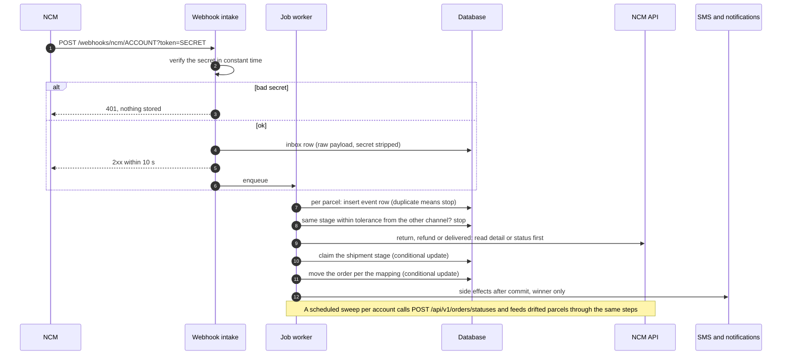

# Nepal Can Move (NCM) integration reference

A single-file reference for integrating the Nepal Can Move courier API into an
e-commerce or order-management project. It is generated from the Claude skill in
[`skills/ncm-integration/`](../skills/ncm-integration/SKILL.md); edit the files
under `skills/ncm-integration/references/` and `docs/src/intro.md`, then run
`python3 scripts/build_reference.py`. Never edit `docs/ncm-integration-reference.md` by hand.

## Sources and labels

| Source | What it is |
|---|---|
| NCM API doc v2 | *NCM API Documentation*, version 2: PDF file name `NCM API DOC V2.pdf`, 32 pages, created 2026-06-21, written against `https://demo.nepalcanmove.com`. The current API document. "v2" is the document's version; most order endpoints are still under `/api/v1/` |
| NCM webhook doc | *NCM Webhook Integration Documentation* v1.1, "Last updated: September 2026", "Beta (subject to changes)". Current, and unchanged since this reference's previous edition |
| NCM API doc v1 | *NCM API Documentation* PDF, file name dated `251222`, 18 pages. Superseded by v2 |
| A production integration | One multi-vendor platform's NCM integration, read in late 2026 and built against the v1 API doc: its code, and its team's production checks |
| Live read-only calls | 23 read-only calls to NCM's production API (`https://portal.nepalcanmove.com`) on 2026-11-16 with one vendor's production token. Only response shapes were recorded; nothing was created or changed |

None of the PDFs is included here; ask NCM for current copies. Only the
read-only calls above were checked against NCM's live API; everything they
didn't cover (create, comments posted, tickets, returns, redirects, webhooks,
limits) is untested.

| Label | Meaning |
|---|---|
| **[doc]** | Stated in NCM's current documents (API doc v2, webhook doc v1.1) |
| **[v1 doc]** | Stated only in the superseded v1 API doc. Kept to help migrate old code |
| **[inferred]** | Follows from the documents without being stated |
| **[observed]** | Seen in the production integration's code. Code shows what it *handles*, not what NCM *sends* |
| **[observed 2026-11-16]** | Returned by NCM's production API to a read-only call on that date. What NCM *sent* to one account that day; not confirmed by NCM, and never [doc] |
| **[reported]** | Reported by that integration's team from production checks |
| **[recommended]** | A design rule for your project |
| **[unknown]** | Not settled by any source, including what API doc v2 leaves unspecified |
| **[NCM, date]** | Answered by NCM outside its documents, recorded in the open questions below |

## Breaking changes from the v1 API doc

| Change | Before [v1 doc] | Now [doc] |
|---|---|---|
| Generic ticket path | `POST /api/v2/vendor/ticket/create` | `POST /api/v2/vendor/ticket/create/new` |
| Pickup tickets | `ticket_type` and `message` | also `branch`, one of the account's assigned pickup branches (`GET /api/v2/vendor/assigned-branches`) |

Everything else in v2 is additive: higher daily limits (1,000 creates and 20,000
reads, up from 200 and 5,000), a documented webhook-URL endpoint and webhook
test, ticket detail and replies, customer list, detail and rating stats,
assigned branches, and label data. The text of every other v1 endpoint is
unchanged, and its path with it.

## Capability matrix

| Capability | NCM endpoint | Documented | Used by the production integration |
|---|---|---|---|
| Branch list | `GET /api/v2/branches` | yes (shape not given; observed live) | yes |
| Assigned pickup branches | `GET /api/v2/vendor/assigned-branches` | yes, new in v2 | no |
| Delivery charge | `GET /api/v1/shipping-rate` | yes (shape not given; observed live) | yes, always `type=Pickup/Collect` |
| Create order | `POST /api/v1/order/create` | yes | yes, one at a time, on confirmation |
| Order detail | `GET /api/v1/order?id=` | yes | yes |
| Order comments; last 25 comments | `GET /api/v1/order/comment?id=`; `GET /api/v1/order/getbulkcomments` | yes | yes |
| Status history; bulk status | `GET /api/v1/order/status?id=`; `POST /api/v1/orders/statuses` | yes | yes (reconciliation) |
| Post a comment | `POST /api/v1/comment` | yes | yes |
| Tickets: create, COD transfer, close | `POST /api/v2/vendor/ticket/create/new`, `…/ticket/cod/create`, `…/ticket/close/<id>` | yes; the create path changed in v2 | create (at the v1 path) and close, for pickup requests; COD transfer unused |
| Ticket detail; ticket reply | `GET /api/v1/tickets/<id>/detail`; `POST /api/v1/vendor/tickets/<id>/response` | yes, new in v2 | detail yes (before it was documented); reply no |
| Staff list | `GET /api/v2/vendor/staffs` | yes | no |
| Return, exchange | `POST /api/v2/vendor/order/return`, `…/exchange-create` | yes | no |
| Redirect | `POST /api/v2/vendor/order/redirect` | yes | yes |
| Register, test webhook URL | `POST /api/v2/vendor/webhook`, `…/webhook/test` | yes, new in v2 (order status URL only) | no |
| Status webhooks | 10 events | yes (webhook doc v1.1) | 5 events; return and refund events were dropped (a mistake, see lessons) |
| Customers; customer detail; rating stats | `GET /api/v2/vendor/customers`, `…/customers/<id>/detail`; `GET /api/v2/vendor/ratings?phone=` | yes, new in v2 | ratings yes (before it was documented); customers no |
| Label data, one or many | `GET /api/v2/vendor/order/label/<id>`; `POST /api/v2/vendor/order/label/` | yes, new in v2 | no |
| `comment_added` webhook | none | no (v2 mentions "comment events" without a payload) | yes |
| Redirectable list | `GET /api/v2/vendor/order/redirectable` | no | yes |
| Cancel or hold an order | none | **not offered** | posts a comment instead |

## Recommended event flow [recommended]



## Discrepancies in NCM's own documents

| # | Topic | What the documents say |
|---|---|---|
| 1 | Webhook URL API | The endpoint is described as managing "webhook URLs" for "order status and comment events", and answers "Webhook URLs updated", but its only parameter is `webhook_url`, the order status URL |
| 2 | Delivery-type names | Three vocabularies: the rate endpoint takes `Pickup/Collect`, `Send`, `D2B`, `B2B`; create takes `Door2Door`, `Branch2Door`, `Door2Branch`, `Branch2Branch`; labels report `Home` or `Office`. The rate-to-create pairing is [inferred] from the rate table's descriptions |
| 3 | Branch list auth | Every other endpoint shows `Authorization: Token`; the branch list shows no header, and answers without one [observed 2026-11-16] |
| 4 | Order detail fields | Five fields documented; the live response carries six more, including `vendor_return` as the string `"False"` [observed 2026-11-16] |
| 5 | Returns | After `rtv_delivery` the order reads `Delivered`, so a return ends looking like a delivery |
| 6 | Vendor spelling | The webhook label is `Send to Vendor`; the order's status is `Sent to Vendor` |
| 7 | Timestamps | Webhooks are UTC; the status, ticket and customer APIs and both test payloads use `+05:45` |
| 8 | Bulk comments | Said to be newest first; the doc's own example isn't sorted |
| 9 | Pickup statuses | `Pickup Order Created` and `Sent for Pickup` appear in API examples but have no webhook event |
| 10 | Undocumented events | `comment_added` [observed] and `returned_to_warehouse` [reported] arrive but aren't listed |
| 11 | Redirect destination | Takes a branch **id**; create takes branch **names**; assigned branches return names and labels return a name and a `code`; no documented source of branch ids. The branch list carries a `pk` [observed 2026-11-16] |
| 12 | Branch-name case | Rates, create and assigned branches use capitals (`TINKUNE`, `KATHMANDU`); the pickup-ticket example sends `Tinkune` |
| 13 | Ticket paths | Create and close are under `/api/v2/vendor/ticket/`; detail is under `/api/v1/tickets/` and replies under `/api/v1/vendor/tickets/`. The v1 create path was dropped without a note |
| 14 | Ticket detail sample | The braces put `responses` beside `ticket`; the indentation puts it inside |
| 15 | Webhook test | Answers `success: true` when your server returned an error status; only `status_code` tells you it failed |
| 16 | Label handling | Labels report `handling` (Fragile, Valuable, ...); create has no field to set it |

## API contract

*Source: `skills/ncm-integration/references/api-contract.md`*

Nepal Can Move (NCM) is a courier in Nepal. This file is the public API contract
as NCM's own documents state it, what changed from the previous API document,
what read-only calls to the live production API returned, and a short, clearly
marked list of behaviour seen in one production integration but not in those
documents.

**Sources**

- *NCM API Documentation*, version 2 (PDF file name `NCM API DOC V2.pdf`, 32 pages, created 2026-06-21; the document itself carries no version number or date). Called **API doc** below. "v2" is the document's version, not a path prefix: create, detail, status, comments and rates are still under `/api/v1/`.
- *NCM Webhook Integration Documentation*, version 1.1, "Last updated: September 2026", status "Beta (subject to changes)". Called **Webhook doc**. Its contract is in [webhooks-and-statuses.md](../skills/ncm-integration/references/webhooks-and-statuses.md). It is the current webhook document, unchanged since the previous edition of this skill; its version number is its own and unrelated to the API doc's.
- *NCM API Documentation* (PDF, file name dated `251222`, 18 pages), the API document v2 replaces. Called **v1 doc**. The API doc restates every v1 endpoint with identical text, except the rows marked breaking in [Changes from the v1 doc](#changes-from-the-v1-doc).
- **Live read-only calls**, 2026-11-16: 23 calls to `https://portal.nepalcanmove.com` with one vendor's production token (22 GETs and the read-only bulk-status POST), at most one every 2.5 s. Only response shapes were recorded: key names, value types and counts, plus enum-like values and amounts. Nothing was created or changed: no order, comment, ticket, return, exchange, redirect or webhook call was made. Endpoints #7, #8, #10–#12, #14–#17, #19–#21, #23, #24 and #26 weren't called. Results are labelled **[observed 2026-11-16]**; every example built from them uses invented values.

**Labels used**

- **[doc]** stated by the current documents (API doc v2, webhook doc v1.1). Example values below are adapted from the documents' examples, with ids, names and dates changed.
- **[v1 doc]** stated only in the superseded v1 doc and dropped from the API doc. Kept so you can recognise and migrate old code; don't build on it.
- **[inferred]** follows from the documents without being stated in them.
- **[observed]** (no date) seen in one production integration's code, not in NCM's documents. Code shows what the integration *handles*, not what NCM *sends*; confirm with NCM before you depend on it.
- **[observed 2026-11-16]** returned by NCM's production API to a read-only call on that date, for one vendor account (see Sources). It shows what NCM *sent*, not what it promises: NCM hasn't confirmed it in writing, and it may change. It never counts as [doc].
- **[reported]** that integration's team reports it from production checks; not visible in its code.
- **[unknown]** no source settles it, including everything the API doc leaves unspecified. Don't fill the gap with a guess.
- **[NCM, date]** answered by NCM outside its documents (email, call, ticket); the answer is recorded in [open-questions.md](../skills/ncm-integration/references/open-questions.md#answers).

### Changes from the v1 doc

| Area | v1 doc [v1 doc] | API doc v2 [doc] | What to do |
|---|---|---|---|
| Generic ticket path | `POST /api/v2/vendor/ticket/create` | `POST /api/v2/vendor/ticket/create/new` | **Breaking.** Move to the new path. Whether the old path still answers is [unknown]; don't rely on it. |
| Pickup tickets | `{"ticket_type", "message"}` | adds `branch`, required when `ticket_type` is `Pickup`; it "must be one of the vendor's assigned pickup branches" | **Breaking.** Send a name from `GET /api/v2/vendor/assigned-branches` (#18). |
| Daily limits | 200 creates, 5,000 reads | 1,000 creates, 20,000 reads (detail, comments, status) | Resize budgets. Scope, reset and over-limit response are still [unknown]. |
| Webhook URL API | named only in the webhook doc, parameters unknown | documented: `{"webhook_url"}` (#17), plus a test endpoint (#19) | Register and test from code if you want to. |
| Ticket detail | not documented; seen in production [observed] | documented (#20) | Parse the documented shape. |
| Customer rating stats | not documented; seen in production [observed] | documented (#24) | Same shape that integration assumed. |
| New endpoints | none | assigned branches (#18), ticket response (#21), customer list and detail (#22, #23), label data for one or many orders (#25, #26) | Use only what the project needs. |
| Everything else | | identical text: auth, host, branch list, delivery rate, create, detail, comments, status history, bulk status, comment create, COD ticket, close ticket, staff, return, exchange, redirect, GET errors | No migration. **Don't rewrite `/api/v1/` paths to `/api/v2/`**: the API doc keeps them. |

Still missing from both: a cancel or hold endpoint, a webhook signature,
idempotency keys, a lookup by `vref_id`, the response shapes of the branch list
and the delivery rate, and a source of the branch ids a redirect needs. The
branch list and rate shapes have since been seen on the live API, and the branch
list carries a `pk` for each branch [observed 2026-11-16] (see [Branches and
rates](#branches-and-rates)). Whether that `pk` is the id a redirect takes is
still [unknown].

### Basics

| Topic | Contract |
|---|---|
| Host | Every example uses `https://demo.nepalcanmove.com` [doc]. The documents don't name the production host. Production is `https://portal.nepalcanmove.com`: it answered a production vendor token sent in the same `Authorization: Token <token>` header [observed 2026-11-16]. Demo and production tokens are separate [reported]: use each token only on its own host. Keep the base URL in configuration, next to the token, never as a constant. |
| Auth | Header `Authorization: Token <api-token>` [doc]. "Every vendor is provided with an API Token Key"; a new or forgotten token comes from NCM's IT admin [doc]. |
| Token scope | One token per vendor (merchant) account [doc]. The integration's code assumes order ids are per-account sequences and that one account's token can't read another's orders [observed]; in one production check the platform token answered for none of 168 ids created under shops' own tokens [reported]. The label endpoints, new in v2, say "only the authenticated vendor's own orders", and the return endpoint (unchanged from the v1 doc) says "Only the vendor who owns the order" [doc]; the order reads say nothing either way. |
| Content type | `Content-Type: application/json` on POST examples [doc]. |
| Daily limits | "Order Creation : 1,000 per day"; "Order View (Detail, Comments, Status ): 20,000 per day" [doc]. Whether the limit is per token, when it resets, what the response is when exceeded, and whether bulk status, labels, customers, ratings and tickets count against the 20,000: [unknown]. The v1 doc's 200 and 5,000 are superseded [v1 doc]. |
| Conduct | "Avoid duplication of order creation from both bulk file upload and api system." "No Spamming or running scripts to overload the server." [doc] |
| Versioning | Paths mix `/api/v1/`, `/api/v1/vendor/`, `/api/v2/` and `/api/v2/vendor/` [doc]; the version belongs to each path, not to the document. Ticket replies are under `/api/v1/vendor/tickets/` (plural) while create and close are under `/api/v2/vendor/ticket/` (singular). No deprecation policy is documented, and the v1 doc's ticket path vanished without a note [unknown]. |
| Pagination | `count`, `next`, `previous`, `results` for the staff list (default 20 per page) and the customer list (default 25, maximum 100) [doc]; both answered in that envelope, with `next` a string and `previous` `null` on the first page [observed 2026-11-16]. The branch list isn't paged: it returned one bare JSON array of every branch, 649 entries and about 240 KB [observed 2026-11-16]. |
| Id fields | Responses don't agree on the id's name [observed 2026-11-16]: branches, staff and comments carry `pk`, customers carry `id`, orders carry `orderid`. The staff list is documented with `id` but returned `pk`. Read the field each endpoint actually sends. |
| Money | Decimal **strings** with two decimals in the order detail (`cod_charge`, `delivery_charge`), the rate (`charge`) and the branch `surcharge`, which can be negative [observed 2026-11-16]. The label's `cod_charge` came back as a JSON **number** [observed 2026-11-16], unlike the order detail's. A rate for an unknown `type` is the string `"0"`, with no decimals (see [Errors](#errors)). Accept both strings and numbers, and parse money as a decimal, never as a float. |
| Response envelope | The webhook and ticket-detail/response endpoints (#17, #19, #20, #21) put `"success": true/false` in the body [doc]. Treat `success: false` as a failure even inside an HTTP 200. The webhook test (#19) answers 200 in all four documented outcomes, and its `success: true` only means NCM reached your server: that test passed only if `status_code` is 2xx. |
| Sandbox | The documents are written against the demo host. Demo and production tokens are separate [reported]; whether the demo shares any data with production is [unknown]. |

### Errors

| Situation | Response [doc] |
|---|---|
| GET without a token | `401 {"detail": "Authentication credentials were not provided."}` (also shown for the bulk label POST) |
| GET without `id` | `400 {"detail": "ID parameter missing"}` |
| GET with an unknown or invalid id | `404 {"detail": "Not found."}`. The doc lists `500 {"detail": "Server Error"}` under the same heading, so a 500 from an order read may mean a bad id rather than a passing fault. Don't retry it blindly. |
| Order create, bad fields | `400 {"Error": {"<field>": "<message>", ...}}` |
| Comment create, bad fields | `400 {"Error": {"Order Id": "...", "Comments": "..."}}` |
| Return, missing id | `400 {"message": "Order ID is required"}` |
| Return, unknown order | `404 {"message": "Order not found"}` |
| Webhook URL not `http://` or `https://` | `400 {"success": false, "message": "Please enter a valid URL for Order Status Webhook (must start with http:// or https://)"}` |
| Webhook test, timeout or no connection | `200 {"success": false, "error": "Request timed out. ..."}` or `"Connection error. ..."` |
| Customer detail, unknown id | `404 {"detail": "Customer not found"}` or `404 {"detail": "Not found"}` |
| Rating stats, no phone; unknown phone | `400 {"detail": "phone parameter is required"}`; `404 {"detail": "No customer found with this phone number"}` |
| Label, unknown order | `404 {"detail": "Order not found"}`. What another vendor's id returns isn't stated [unknown]; the bulk endpoint puts those in `not_found`. |
| Bulk labels, empty or missing `ids` | `400 {"detail": "\"ids\" must be a non-empty array"}` |

Error bodies use four shapes: `detail`, `Error` (an object keyed by field),
`message`, and `success: false` with `message` or `error`. Parse all of them.
Not documented [unknown]: the response to a rate limit (for example 429), the
"forbidden" answer from ticket detail, and errors from ticket create, COD
ticket, close, staff, exchange, redirect, assigned branches and ticket
response. Expect HTML error pages, from proxies and, with HTTP 200, from the
rate endpoint itself (below). Never show a raw body to an end user.

**Seen on production** [observed 2026-11-16]. Each row comes from one read-only
call; none is confirmed by NCM.

| Situation | Response |
|---|---|
| Order detail without `id` | `400 {"detail": "ID parameter missing"}`, as documented |
| Order detail, an id that doesn't exist | `404 {"detail": "Not found."}`, as documented |
| Bulk status with an id that doesn't exist | `200`; that id is listed in `errors` as an integer, and the known id is answered in `result` |
| Rate with an unknown `type`, including `B2D`, which isn't one of the four documented types | `200 {"charge": "0"}`. **Not an error status.** |
| Rate with a branch `code` or `pk` in place of the name, or a branch name NCM doesn't know | `200` with an HTML page titled "Sorry, Something went wrong", not JSON |
| Branch list without a token | `200` with the full list: it needs no token |

So a rate request can fail with HTTP 200 in two ways. Treat a body that isn't
JSON, or a `charge` of `"0"`, as a failed quote: never show it as free delivery.

### Endpoint catalog

Every endpoint takes `Authorization: Token <api-token>` unless the row says otherwise. Numbers are this file's own, kept stable across editions.

| # | Purpose | Method and path | Request | Success response [doc] |
|---|---|---|---|---|
| 1 | Branch list with details (phone, covered areas, district, region) | `GET /api/v2/branches` | none | Shape **not documented** in the doc, which shows no auth header for this one. Live: `200`, one bare array of every branch, not paged, and the same answer with no token [observed 2026-11-16]. Each item is `{"pk", "code", "name", "geocode", "address", "surcharge", "phone", "phone2", "branch_type", "areas_covered", "province_name", "district_name"}` [observed 2026-11-16]; see [Branches and rates](#branches-and-rates). It is the only response that carries branch ids (`pk`), which the redirect endpoint needs; one integration reads them here too [observed]. |
| 2 | Delivery charge between branches | `GET /api/v1/shipping-rate?creation=<from>&destination=<to>&type=<type>` | query `creation` (pickup branch), `destination` (destination branch), `type` (below). The doc's example uses branch **names** in capitals (`creation=TINKUNE&destination=POKHARA`) [doc]. Only names work: a branch `code` or `pk` gets the same HTML error page as an unknown name [observed 2026-11-16]. | Shape **not documented** in the doc. Live: `200 {"charge": "<decimal string>"}`; an unknown `type` gets `200 {"charge": "0"}` [observed 2026-11-16]. |
| 3 | One order's detail | `GET /api/v1/order?id=<ncm-order-id>` | query `id` | `{"orderid", "cod_charge", "delivery_charge", "last_delivery_status", "payment_status"}`. Live: those five plus `vendor_return` (a **string**), `trackid`, `active`, `delivered_date`, `destination_branch_name` and `destination_branch_phone` [observed 2026-11-16]; see [Order detail](#order-detail). |
| 4 | One order's comments, newest first | `GET /api/v1/order/comment?id=<ncm-order-id>` | query `id` | array of `{"orderid", "comments", "addedBy", "added_time"}`. Live: each item also carries `pk`, an integer [observed 2026-11-16]. |
| 5 | Last 25 comments across the account's orders | `GET /api/v1/order/getbulkcomments` | none | same item shape as #4. Live: 25 items, `pk` included [observed 2026-11-16]. |
| 6 | One order's status history, newest first | `GET /api/v1/order/status?id=<ncm-order-id>` | query `id` | array of `{"orderid", "status", "added_time"}`. Live: each item also carries `vendor_return`, a string [observed 2026-11-16]. |
| 7 | Create an order | `POST /api/v1/order/create` | JSON, see [Create an order](#create-an-order) | `200 {"Message": "Order Successfully Created", "orderid": <int>}` |
| 8 | Add a comment to an order | `POST /api/v1/comment` | `{"orderid", "comments"}`, both required | `200 {"message": "Comment successfully created"}` |
| 9 | Current status of many orders | `POST /api/v1/orders/statuses` | `{"orders": [<int>, ...]}` | `200 {"result": {"<id>": "<status>"}, "errors": [<id>, ...]}`. Live: as documented; an id that doesn't exist is listed in `errors` as an integer [observed 2026-11-16]. |
| 10 | Support ticket, including pickup requests | `POST /api/v2/vendor/ticket/create/new` | `{"ticket_type", "message", "branch"?}`; `message` max 500 chars; `branch` required for `Pickup`. See [Tickets](#tickets). | `201 {"message": "Ticket created", "ticket": <int>}`. The v1 doc's path `/api/v2/vendor/ticket/create` is gone [v1 doc]. |
| 11 | COD transfer request ticket | `POST /api/v2/vendor/ticket/cod/create` | `{"bankName", "bankAccountName", "bankAccountNumber"}`, all required | `201 {"message": "COD ticket created", "ticket": <int>}` |
| 12 | Close own ticket | `POST /api/v2/vendor/ticket/close/<ticket_id>` | ticket id in the path (`pk`) | `200 {"message": "Ticket closed", "ticket": <int>}` |
| 13 | Active staff list | `GET /api/v2/vendor/staffs?q=&page=&page_size=` (`limit` is an alias of `page_size`) | all optional; `page` default 1, `page_size` default 20 | `{"count", "next", "previous", "results": [{"id", "name", "email", "phone"}]}`. Live: items carry `pk`, **not** `id`, plus `role` (a string) and `status` (a boolean) [observed 2026-11-16]. |
| 14 | Mark an order for return | `POST /api/v2/vendor/order/return` | `{"pk": <order id>, "comment"?}` | `200 {"message": "Order marked for return successfully", "order": <int>, "vendor_return": true}` |
| 15 | Exchange (replacement plus pickup of the old item) | `POST /api/v2/vendor/order/exchange-create` | `{"pk": <original order id>}` | `200 {"message": "Exchange orders created", "cust_order": <int>, "ven_order": <int>}` |
| 16 | Redirect to another address or customer | `POST /api/v2/vendor/order/redirect` | see [Redirect](#redirect) | `200 {"message", "order", "cod_charge", "delivery_charge", "changelogs"}` |
| 17 | Set or remove the order status webhook URL | `POST /api/v2/vendor/webhook` | `{"webhook_url": "<http(s) URL>"}`; `""` removes it. See [Webhook registration and test](#webhook-registration-and-test). | `201 {"success": true, "message": "Webhook URLs created successfully!"}` the first time, then `200 {"success": true, "message": "Webhook URLs updated successfully!"}` |
| 18 | Pickup branches assigned to the account | `GET /api/v2/vendor/assigned-branches` | none | `200 ["<BRANCH NAME>", ...]`: names only; `[]` when none are assigned. Live: as documented, an array of strings [observed 2026-11-16]. |
| 19 | Send a test webhook | `POST /api/v2/vendor/webhook/test` | `{"webhook_url": "<url>"}` | `200` in every documented outcome, failures included; read `success` and `status_code` |
| 20 | One ticket with its responses | `GET /api/v1/tickets/<ticket_id>/detail` | ticket id in the path; a vendor sees only its own tickets | `200 {"success": true, "ticket": {...}, "responses": [...]}` |
| 21 | Reply to a ticket | `POST /api/v1/vendor/tickets/<ticket_id>/response` | `{"message"}` | `201 {"success": true, "ticket_id": <int>, "response": {"id", "message", "added_on", "vendor_display", "added_by": {"id", "name"}}}`. **Reopens a closed ticket.** |
| 22 | The account's customers | `GET /api/v2/vendor/customers?page=&page_size=&name=&phone=` | all optional; `page_size` default 25, max 100; `name` contains, `phone` starts with | `{"count", "next", "previous", "results": [{"id", "name", "phone", "address"}]}`. Live: as documented, `id` included [observed 2026-11-16]. |
| 23 | One customer with order history | `GET /api/v2/vendor/customers/<customer_id>/detail` | customer id in the path | `{"id", "name", "phone", "email", "orders": [{"orderid", "created_date", "cod_charge", "delivery_charge", "last_delivery_status"}]}` |
| 24 | A phone's delivery record across NCM | `GET /api/v2/vendor/ratings?phone=<phone>` | `phone` required | `{"phone", "total_orders", "total_delivered", "total_returned"}` |
| 25 | Label data for one order | `GET /api/v2/vendor/order/label/<order_id>` | order id in the path; own orders only | a label object, see [Label data](#label-data). Live: the documented keys, but `cod_charge` is a JSON **number** [observed 2026-11-16]. |
| 26 | Label data for many orders | `POST /api/v2/vendor/order/label/` (trailing slash as documented) | `{"ids": [<int>, ...]}`, non-empty | `200 {"labels": [<label>, ...], "not_found": [<id>, ...]}` |

Not offered by the documents: cancelling an order, creating an order on hold, a
dedicated pickup-request endpoint (a `Pickup` ticket stands in), a COD
remittance or settlement statement, idempotency keys, a lookup by `vref_id`, a
printable label or AWB file (#25 and #26 return label **data**), reading back
the registered webhook URL.

#### Delivery types

The rate endpoint and the create endpoint name the four services differently,
and the label endpoints add a third, coarser vocabulary. The rate table
describes each `type` with the words create takes as `delivery_type`
(`Pickup/Collect` is "Door2Door (NCM pickup & delivery)", `D2B` is "Door2Branch
(...)"), so the pairing is all but stated. The doc never says outright to send
one for the other, so the pairing below is marked [inferred]; the names and
charges in each row are [doc]. The label column is [doc]: labels report
`Office` for D2B and B2B orders and `Home` for all others.

| Service | Rate `type` | Create `delivery_type` | Label `delivery_type` | Charge, as the rate table words it |
|---|---|---|---|---|
| NCM picks up from the sender and delivers to the door | `Pickup/Collect` | `Door2Door` (the default) | `Home` | full base charge |
| Sender drops at a branch, NCM delivers to the door | `Send` | `Branch2Door` | `Home` | full base charge |
| NCM picks up, customer collects at a branch | `D2B` | `Door2Branch` | `Office` | base charge − 50 |
| Sender drops at a branch, customer collects at a branch | `B2B` | `Branch2Branch` | `Office` | base charge − 50 |

"Base charge − 50" is the doc's wording; it gives no unit or base. Read the
charge from the rate endpoint; never compute it yourself. Keep one mapping table
in code. Don't send a rate `type` to the create endpoint, and never send a label
value (`Home`, `Office`) to either.

[observed 2026-11-16] For one pair of branches, `Pickup/Collect` and `Send`
returned the same charge, and `D2B` and `B2B` returned 50 less, as the table
says. `B2D` isn't a rate type: like any unknown `type`, it got
`200 {"charge": "0"}` instead of an error. Send exactly one of the four
documented values.

#### Branches and rates

`GET /api/v2/branches` returns one bare JSON array of every branch, with no
paging and no envelope [observed 2026-11-16]. Invented values, observed shape:

```json
[
  {
    "pk": 101,
    "code": "EXMPL1",
    "name": "EXAMPLE BRANCH",
    "geocode": "<geocode>",
    "address": "Example Road",
    "surcharge": "25.00",
    "phone": "0100000000",
    "phone2": null,
    "branch_type": "Branch",
    "areas_covered": "<covered areas, one string>",
    "province_name": "Example Province",
    "district_name": "Example District"
  }
]
```

- 649 branches that day, about 240 KB. Cache the list and refresh it on a schedule, not per request.
- It answered without a token with the same list, and answers with one too [observed 2026-11-16].
- `pk` is an integer and is the only branch id any response carries. The redirect's `destination` needs a branch id; whether it is this `pk` is [unknown], since redirect wasn't called.
- `branch_type` was `Branch` or `Logistics`. What `Logistics` means, and whether such a branch can be a pickup or destination branch, is [unknown].
- `surcharge` is a decimal string and can be negative. How it relates to the rate is [unknown]; take the charge from the rate endpoint.
- `geocode`, `address`, `areas_covered` and `phone2` can be `null`. `areas_covered` is one string, not a list, and `phone2` isn't always digits only; their formats are [unknown]. `phone` was digits only.

`GET /api/v1/shipping-rate?creation=TINKUNE&destination=POKHARA&type=Pickup/Collect`
→ `200 {"charge": "150.00"}` (the amount is invented) [observed 2026-11-16].

- `charge` is a decimal string with two decimals.
- Only branch **names** work. A branch's `code` or `pk`, or a name NCM doesn't know, gets HTTP `200` with an HTML page titled "Sorry, Something went wrong".
- An unknown `type` gets `200 {"charge": "0"}`, with no decimals.
- Before using a quote, check that the body is JSON and that `charge` isn't `"0"`. Whether a real charge can ever be `"0"` is [unknown].
- Whether names are matched case-sensitively wasn't tested [unknown]; send the capitals the doc uses.

#### Create an order

`POST /api/v1/order/create` [doc]

| Field | Required | Meaning |
|---|---|---|
| `name` | yes | customer name |
| `phone` | yes | customer phone |
| `phone2` | no | secondary phone |
| `cod_charge` | yes | "cod amount including delivery": the cash NCM collects from the customer |
| `address` | yes | general address of the customer |
| `fbranch` | yes | **name** of the origin (from) branch |
| `branch` | yes | **name** of the destination branch |
| `package` | no | package name or type |
| `vref_id` | no | vendor reference id: your own order reference |
| `instruction` | no | delivery instruction |
| `delivery_type` | no | `Door2Door`, `Branch2Door`, `Branch2Branch`, `Door2Branch`; default `Door2Door` |
| `weight` | no | kg; default 1 |

The example sends every value as a JSON string, numbers included [doc]. Not
documented [unknown]: field length limits, accepted phone formats, whether
`cod_charge` may be `"0"` for a prepaid order, whether `vref_id` must be unique
or is checked for duplicates, whether `fbranch` must be one of the account's
assigned pickup branches (#18), and how to mark a parcel fragile or valuable
(the label reports a `handling` value, but create has no field for it).

Synthetic request:

```json
{
  "name": "Test Customer",
  "phone": "98XXXXXXXX",
  "phone2": "",
  "cod_charge": "1500",
  "address": "Example Tole, Ward 1",
  "fbranch": "<ORIGIN_BRANCH_NAME>",
  "branch": "<DESTINATION_BRANCH_NAME>",
  "package": "1 x Example item",
  "vref_id": "SHOP-ORDER-0001",
  "instruction": "Call before delivery",
  "delivery_type": "Door2Door",
  "weight": "1"
}
```

Success: `200 {"Message": "Order Successfully Created", "orderid": 1001}`. Note the capital `M` in `Message`. The `orderid` is the NCM order id every later call takes.

Failure: `400 {"Error": {"phone": "Invalid Phone Number", "branch": "Invalid Branch"}}`. The documented messages are `"Invalid COD Amount"`, `"Invalid Phone Number"`, `"Invalid Branch"`, `"Invalid Name"`, `"Invalid Address"`.

**No idempotency.** Nothing in the contract stops a retried create making a second parcel [doc: no such mechanism is described]. See [checklists.md](../skills/ncm-integration/references/checklists.md) for the claim-before-call pattern.

**Finding a parcel after a timed-out create** [inferred]. The API still can't
look a parcel up by `vref_id`, but the API doc's new endpoints allow a search:
filter customers by phone (#22), take that customer's orders (#23) created
around the time of the attempt, and read each candidate's label (#25), whose
`description.vendor_orderid` appears to echo `vref_id`. Show the person only
candidates whose label read succeeds: labels cover your own orders only, while
the `orders` from #23 may include other vendors' (see [Customers and rating
stats](#customers-and-rating-stats)). None of this is documented for the
purpose. Whether a new order shows up there at once, and whether
`vendor_orderid` is `vref_id`, are [unknown]. Use it to help a person resolve an
`unknown` create, never to justify an automatic retry.

#### Order detail

`GET /api/v1/order?id=1001` → [doc]

```json
{
  "orderid": 1001,
  "cod_charge": "1500.00",
  "delivery_charge": "150.00",
  "last_delivery_status": "Delivered",
  "payment_status": "Completed"
}
```

A production order that was waiting for pickup returned the five documented
fields and six more [observed 2026-11-16]. Invented values, observed shape:

```json
{
  "orderid": 1001,
  "cod_charge": "1500.00",
  "delivery_charge": "150.00",
  "last_delivery_status": "Sent for Pickup",
  "payment_status": "Delivery Pending",
  "vendor_return": "False",
  "trackid": "<tracking id>",
  "active": true,
  "delivered_date": null,
  "destination_branch_name": "<DESTINATION_BRANCH_NAME>",
  "destination_branch_phone": "0100000000"
}
```

- Money is a decimal **string** [doc], with two decimals [observed 2026-11-16]. Parse it as a decimal, never as a float.
- `payment_status` was `"Delivery Pending"` on that undelivered parcel [observed 2026-11-16]; the doc shows `"Completed"`. The full list, and what `"Completed"` means (cash collected from the customer, or paid out to the vendor), are **not documented** [unknown]. Don't read either as "the vendor has been paid".
- **`vendor_return` is a string**: `"False"` in the observed response [observed 2026-11-16]. A non-empty string is truthy in most languages, so `if detail["vendor_return"]` takes `"False"` for a return. Compare the text case-insensitively, and accept a real boolean too, since the return endpoint's documented response uses one [doc]. Only `"False"` was seen; that a returned parcel reads `"True"` is [inferred]. One integration's parser reads it as a boolean [observed]; check how yours parses it. Its production data holds NCM's `vendor_return` answers for many parcels [reported], and its return handling depends on them.
- `trackid` (a string), `active` (a boolean) and `delivered_date` (`null` before delivery) are present too [observed 2026-11-16]. That integration's parser reads them [observed]. `destination_branch_name` and `destination_branch_phone` are new. None of these six fields is documented; confirm with NCM before depending on one.

#### Status history and bulk status

`GET /api/v1/order/status?id=1001` returns newest first [doc]:

```json
[
  {"orderid": 1001, "status": "Delivered",            "added_time": "2026-01-02T13:24:30.960365+05:45"},
  {"orderid": 1001, "status": "Sent for Delivery",    "added_time": "2026-01-02T13:22:21.033595+05:45"},
  {"orderid": 1001, "status": "Pickup Complete",      "added_time": "2026-01-02T13:17:25.326792+05:45"},
  {"orderid": 1001, "status": "Sent for Pickup",      "added_time": "2026-01-02T13:15:24.313074+05:45"},
  {"orderid": 1001, "status": "Pickup Order Created", "added_time": "2025-12-30T11:32:18.149352+05:45"}
]
```

`added_time` carries a `+05:45` offset (Nepal) in the examples [doc], and did live [observed 2026-11-16]. Sort by the parsed time rather than trusting array order. Live rows also carry `vendor_return`, a string such as `"False"` [observed 2026-11-16]; parse it as in [Order detail](#order-detail).

`POST /api/v1/orders/statuses` with `{"orders": [1001, 1002, 1003, 1004, 1005]}` [doc]:

```json
{
  "result": {"1001": "Pickup Order Created", "1002": "Arrived", "1004": "Drop off Order Created", "1005": "Delivered"},
  "errors": [1003]
}
```

- Ids go in as integers and come back as **string keys** [doc].
- `errors` lists ids NCM could not answer for. An id that doesn't exist lands there as an integer, while a known id in the same call is answered in `result` [observed 2026-11-16]. Other causes of an error entry are [unknown].
  - [observed] One integration found most of its long-stuck parcels listed here, while control parcels on the same token answered normally.
  - [reported] Ids created under another account's token went unanswered in one production check, so group ids by the token that created them.
- Maximum batch size: [unknown]. One integration uses 100.
- Whether a bulk call counts as one read or one per id against the 20,000 daily reads: [unknown].

#### Comments

`GET /api/v1/order/comment?id=1001` → newest first [doc]:

```json
[{"orderid": 1001, "comments": "Customer not reachable", "addedBy": "NCM Staff", "added_time": "2026-01-02T16:43:15.687200+05:45"}]
```

`addedBy` values seen in the doc: `"NCM Staff"`, `"Vendor"`. Comment ids are **not** in the documented response [doc]; one integration's code notes that the comment list "has not always included comment_id" and reads it when present [observed]. Live, every row from both comment endpoints (#4, #5) carried `pk`, an integer [observed 2026-11-16], most likely the comment's id [inferred]. Whether it equals a webhook's `comment_id` is [unknown].

De-duplicate on (account, NCM order id, comment id) when one is present,
taking `pk` from API rows, else on (account, NCM order id, text, `addedBy`,
`added_time`). Until NCM confirms that `pk` and a webhook's `comment_id` are
the same id, match comments across the two channels on text, `addedBy` and time
as well. Your own comments come back with `addedBy: "Vendor"`; match them to the
local comment by text within a few minutes rather than storing them twice.

`GET /api/v1/order/getbulkcomments` returns the last 25 comments across the account's orders, "latest comments ... at the top" [doc]; it returned 25 rows [observed 2026-11-16]. The doc's own example is not strictly newest first, so sort locally. With only 25 rows, a busy account can lose comments between polls; use it as a supplement, not the only feed.

`POST /api/v1/comment` with `{"orderid": "1001", "comments": "Please call before 5pm"}` → `200 {"message": "Comment successfully created"}` [doc]. No comment id comes back [doc]. A length limit is [unknown].

**A comment post isn't idempotent.** After a timeout or a 5xx, NCM may already
have stored the comment. Before posting again, read the thread
(`GET /api/v1/order/comment?id=`) and look for the same text from `Vendor`.

#### Tickets

**Create** `POST /api/v2/vendor/ticket/create/new` [doc]

| Field | Required | Meaning |
|---|---|---|
| `ticket_type` | yes | `General`, `Order Processing`, `Return` or `Pickup` |
| `message` | yes | at most 500 characters |
| `branch` | only for `Pickup` | "must be one of the vendor's assigned pickup branches" (#18) |

Synthetic pickup request, in the doc example's message format:

```json
{"ticket_type": "Pickup", "message": "98XXXXXXXX, No. of Packets: 5, Address: Example Tole", "branch": "<ASSIGNED_BRANCH_NAME>"}
```

→ `201 {"message": "Ticket created", "ticket": 2001}` [doc].

- The doc's example sends `"branch": "Tinkune"`, while #18 returns names in capitals (`"KATHMANDU"`) [doc]. Whether the match is case-sensitive is [unknown]; send the name exactly as #18 returns it.
- The error for a missing or unassigned `branch` is [unknown].
- There is still no dedicated pickup endpoint. A `Pickup` ticket is how you ask NCM to collect [inferred from the ticket types and the example].
- Whether a ticket type is meant for cancelling an order is [unknown]; none is named for it.

**COD transfer** `POST /api/v2/vendor/ticket/cod/create` with `bankName`,
`bankAccountName` and `bankAccountNumber` → `201 {"message": "COD ticket
created", "ticket": <int>}` [doc]. The bank details are sensitive: never log
them, and confirm with the business who may file one. What NCM does next, and
how a transfer is reported back, is [unknown].

**Close** `POST /api/v2/vendor/ticket/close/<ticket_id>` → `200 {"message": "Ticket closed", "ticket": <int>}`, for your own tickets [doc].

**Detail** `GET /api/v1/tickets/<ticket_id>/detail` [doc]. A vendor sees only its own tickets; "other roles are forbidden".

```json
{
  "success": true,
  "ticket": {
    "id": 2001,
    "ticket_type": "Pickup",
    "message": "98XXXXXXXX<br>No. of Packets: 5<br>Address: Example Tole<br>Actual Pickup count : 4",
    "added_on": "2026-01-05T11:28:00+05:45",
    "status": false,
    "comment": "",
    "attachment": null,
    "branch": "<ASSIGNED_BRANCH_NAME>",
    "closed_on": null,
    "vendor": {"id": 501, "name": "Example Vendor", "location": "27.70,85.30"},
    "assigned_to": {"id": 43, "name": "Example Logistics"},
    "closed_by": {"id": null, "name": null}
  },
  "responses": [
    {"id": 3001, "message": "Please pick up tomorrow morning.", "added_on": "2026-01-05T12:10:00+05:45", "vendor_display": true, "added_by": {"id": 501, "name": "Example Vendor"}}
  ]
}
```

- `status` is a boolean, and the doc doesn't say which value means open. The example pairs `false` with `closed_on: null`, so `false` is probably open [inferred]. Read `closed_on` too, and confirm with NCM.
- `message` holds `<br>` line breaks, and the doc's example ends with an "Actual Pickup count" line the vendor didn't write [doc]. Turn the `<br>` into line breaks and escape the rest before display; never render it as HTML.
- In the doc's example the braces put `responses` beside `ticket`, at the top level, while the indentation suggests it sits inside `ticket` [doc]. Read it from either place.
- The shape of the "forbidden" answer is [unknown].

**Respond** `POST /api/v1/vendor/tickets/<ticket_id>/response` with
`{"message": "..."}` → `201 {"success": true, "ticket_id": 2001, "response":
{"id", "message", "added_on", "vendor_display": true, "added_by": {"id",
"name"}}}` [doc].

- **Replying to a closed ticket reopens it** [doc]. Read the ticket first unless reopening is what you want.
- A retried reply probably posts twice, since nothing makes it idempotent [inferred]. A length limit is [unknown].

#### Return, exchange, redirect

**Return** `POST /api/v2/vendor/order/return` `{"pk": 1001, "comment": "Customer refused"}` [doc]:
- sets the order's `vendor_return` flag to `true`;
- with a comment, creates an external comment with status "Pending";
- only the vendor who owns the order may do it.

Record every return you request this way: the same `vendor_return` flag is what
a post-delivery check reads to detect a return NCM started.

**Exchange** `POST /api/v2/vendor/order/exchange-create` `{"pk": 1001}` [doc]: creates two orders, `cust_order` (a new delivery to the customer) and `ven_order` (the old item back to the vendor).

<a id="redirect"></a>**Redirect** `POST /api/v2/vendor/order/redirect` [doc]:

| Field | Required | Meaning |
|---|---|---|
| `pk` | yes | NCM order id |
| `name`, `phone`, `address` | yes | the new customer |
| `vendorOrderid` | no | your reference |
| `destination` | no | new destination **branch id** (an integer, unlike create, which takes branch names) [doc]. No documented endpoint returns branch ids: #18 gives names, and labels (#25) give a name and a `code` such as `TINK1` [doc]. The branch list (#1) carries an integer `pk` per branch [observed 2026-11-16], and one integration reads branch ids there [observed]; whether `destination` takes that `pk` is [unknown]. |
| `cod_charge` | no | new COD amount (decimal) |

The response carries the new `cod_charge` and `delivery_charge` as strings, and `changelogs` as free text. A changed branch adds an `RDRT-DiFF-BRNCH` charge; the same branch adds a `REDIRECT` charge. A phone NCM doesn't know creates a customer record [doc]. Which orders may be redirected is [unknown] in the doc. [observed] One integration reads an undocumented `GET /api/v2/vendor/order/redirectable` list.

#### Webhook registration and test

**Register** `POST /api/v2/vendor/webhook` [doc]:

```json
{"webhook_url": "https://shop.example/webhooks/ncm/acct_1?token=<SECRET>"}
```

- `201 {"success": true, "message": "Webhook URLs created successfully!"}` the first time, `200 {"success": true, "message": "Webhook URLs updated successfully!"}` after that.
- `{"webhook_url": ""}` removes the stored URL.
- A URL that doesn't start with `http://` or `https://` gets a `400` with `success: false`.
- It sets the vendor portal's "Order Delivery Webhook URL", which receives every status event: the webhook doc follows the portal steps for that field with "You can also set or remove the URL through the API with POST /api/v2/vendor/webhook" [doc].
- [unknown] The doc says the endpoint manages "webhook URLs" for "order status and comment events", but its only parameter is `webhook_url`, described as the order status URL. How to set a comment webhook URL through the API, and what a comment event looks like, aren't documented.
- [unknown] No endpoint reads the stored URL back, and whether a change takes effect at once isn't said.

**Test** `POST /api/v2/vendor/webhook/test` with `{"webhook_url": "<url>"}` [doc]. NCM posts this test payload to that URL and reports what happened:

```json
{"event": "order.status.changed", "order_id": "TEST-123456", "status": "In Transit", "timestamp": "2026-01-02T12:00:00+05:45", "test": true}
```

| What happened | NCM's answer (HTTP 200 in every documented case) |
|---|---|
| your server answered 2xx | `{"success": true, "status_code": 200, "response": "OK"}` |
| your server answered an error | `{"success": true, "status_code": 400, "response": "Bad Request", "headers": {"Content-Type": "text/plain"}}` |
| no answer within 10 seconds | `{"success": false, "error": "Request timed out. The webhook URL did not respond within 10 seconds."}` |
| no connection | `{"success": false, "error": "Connection error. Could not connect to the webhook URL. Details: ..."}` |

**`success: true` only means NCM got an HTTP answer.** The test passed only if
`status_code` is 2xx.

- Pass the full URL, secret included. The test reaches your receiver like a real event; authenticate it and record it as a test (see [webhooks-and-statuses.md](../skills/ncm-integration/references/webhooks-and-statuses.md#payloads-doc)).
- [unknown] whether the test carries the same headers as real webhooks (`User-Agent: NCM-Webhook/1.0`), whether the URL must be the registered one (the doc lets you pass any URL), and the endpoint's own errors, such as a missing token or `webhook_url`.

#### Customers and rating stats

These endpoints return personal data. Call them only for a purpose the business
has agreed, and never log names, phones, emails or addresses.

- **List** `GET /api/v2/vendor/customers` [doc]: customers "either created by you or who have received at least one of your orders". Filters `name` (contains) and `phone` (starts with); `page` default 1, `page_size` default 25, maximum 100. Results are `{"id", "name", "phone", "address"}`; `address` may be `""`. The live list matched this shape [observed 2026-11-16]. What happens above 100 per page is [unknown].
- **Detail** `GET /api/v2/vendor/customers/<customer_id>/detail` [doc]: `{"id", "name", "phone", "email", "orders": [...]}`, each order `{"orderid", "created_date", "cod_charge", "delivery_charge", "last_delivery_status"}`. A 404 carries either `"Customer not found"` or `"Not found"`.
  - [unknown] The doc calls `orders` the "complete order history". Whether it holds only your account's orders, or the customer's orders with other vendors too, isn't said. Don't show it to staff or vendors until you know.
- **Rating stats** `GET /api/v2/vendor/ratings?phone=<phone>` [doc]: `{"phone", "total_orders", "total_delivered", "total_returned"}` "across the entire NCM system". `400` without `phone`. A `404 {"detail": "No customer found with this phone number"}` means no history, not a failure.
  - It describes a customer's orders with other vendors. Check with the business, and with NCM's terms, before using it to refuse or flag customers.
  - Accepted phone formats are [unknown]; one integration sends 10 digits [observed].

#### Label data

`GET /api/v2/vendor/order/label/1001` returns what a delivery label needs, for one of your own orders [doc]:

```json
{
  "orderid": 1001,
  "delivery_type": "Home",
  "cod_charge": "1500.00",
  "from_branch": {"name": "<ORIGIN_BRANCH_NAME>", "code": "<BRANCH_CODE>", "district": "<DISTRICT>"},
  "to_branch": {"name": "<DESTINATION_BRANCH_NAME>", "code": "<BRANCH_CODE>", "district": "<DISTRICT>"},
  "from": {"name": "Example Vendor", "phone": "98XXXXXXXX", "phone2": ""},
  "receiver": {"name": "Test Customer", "phone": "98XXXXXXXX", "phone2": "", "address": "Example Tole, Ward 1"},
  "description": {"description": "1 x Example item", "delivery_instruction": "Call before delivery", "handling": "Non-Fragile", "vendor_orderid": "SHOP-ORDER-0001"}
}
```

`POST /api/v2/vendor/order/label/` with `{"ids": [1001, 1002, 9999]}` → [doc]

```json
{"labels": [{"orderid": 1002, "delivery_type": "Office", "cod_charge": "2200.00"}, {"orderid": 1001, "delivery_type": "Home", "cod_charge": "1500.00"}], "not_found": [9999]}
```

(Labels shortened here; each is the full object above.)

- [observed 2026-11-16] One production label had exactly the documented keys, but its `cod_charge` was a JSON **number**, not a decimal string like the order detail's. Parse both forms to the same decimal. Its `delivery_type` was `Home`, and its `phone2` fields were `""`.
- `delivery_type` is `Office` for D2B and B2B orders and `Home` for the rest ([Delivery types](#delivery-types)).
- `from` holds the vendor for vendor orders, or the sending customer otherwise. Which orders aren't vendor orders is [unknown].
- `description` fields are `null` when the order has no description. Whether the whole `description` object can be `null` is [unknown]; handle both.
- `handling` is `Fragile`, `Fragile and Valuable`, `Valuable` or `Non-Fragile`.
- `labels` can come back in any order: match on `orderid`. Ids that don't exist **and ids that belong to another vendor** both land in `not_found`, indistinguishably [doc].
- NCM recommends 100 ids or fewer per request; no hard limit is stated [doc].
- Keep the trailing slash on the POST path as documented.
- [inferred] `description.description`, `delivery_instruction` and `vendor_orderid` echo create's `package`, `instruction` and `vref_id`.
- [unknown] what a barcode or QR code on the label should encode, whether NCM offers a printable file, and whether label reads count against the 20,000 daily reads.

### Undocumented endpoints seen in production

[observed] One production integration calls this. It is not in the documents. Treat it as unstable, and confirm with NCM before use.

| Path | What the integration uses it for | Response shape it assumes |
|---|---|---|
| `GET /api/v2/vendor/order/redirectable` | which of the account's orders may be redirected now | paginated `{count, next, previous, results: [{orderid, branch, last_delivery_status}]}`, following `next` |

Two endpoints that integration called without documentation are now in the API
doc: rating stats (#24), whose documented shape matches what it assumed, and
ticket detail (#20), where it parsed a status loosely from `status`,
`ticket_status` or similar, and the doc puts a boolean at `ticket.status`.

The same integration retries an order-detail read when the error text matches "expected available in N seconds", which is Django REST framework's throttling wording [observed]. Whether NCM sends it, and with which HTTP status, is [unknown].

### What to ask NCM before go-live

The open questions, with their status and NCM's answers as they arrive, are
tracked in [open-questions.md](../skills/ncm-integration/references/open-questions.md). Ask them before go-live.

## Webhooks, statuses and status processing

*Source: `skills/ncm-integration/references/webhooks-and-statuses.md`*

Labels:
- **[doc]** NCM's current documents: the webhook doc v1.1 (September 2026, "Beta") and the API doc v2 (see [api-contract.md](../skills/ncm-integration/references/api-contract.md) for both). Example values are adapted, with ids and dates changed.
- **[v1 doc]** only in the superseded API doc dated `251222`.
- **[inferred]** follows from the documents without being stated in them.
- **[observed]** seen in one production integration's code, not in NCM's documents. Code shows what the integration *handles*, not what NCM *sends*; confirm with NCM.
- **[reported]** that integration's team reports it from production checks; it is not visible in its code.
- **[recommended]** a design rule for your project.
- **[unknown]** not settled by any source.
- **[NCM, date]** answered by NCM outside its documents; see [open-questions.md](../skills/ncm-integration/references/open-questions.md#answers).

### The webhook contract [doc]

**Setup.** Either in the NCM vendor portal: API section (`/accounts/vendor/api`)
→ "Webhook/API Callback URLs" → put your URL in **"Order Delivery Webhook URL"**
→ "Test Webhook" → "Add/Update" [doc]. Or through the API [doc]:
- `POST /api/v2/vendor/webhook` with `{"webhook_url": "<url>"}` sets it (`""` removes it);
- `POST /api/v2/vendor/webhook/test` with `{"webhook_url": "<url>"}` sends a test event and answers **200 even when the test failed**: the test passed only if `status_code` in the answer is 2xx, whatever `success` says.

The webhook doc says the API sets the same URL as the portal field [doc].
Details and responses: [api-contract.md](../skills/ncm-integration/references/api-contract.md#webhook-registration-and-test).

**URL.** Valid HTTP or HTTPS; HTTPS recommended; may include query parameters.
NCM's own example is `https://your-domain.com/api/ncm-webhook?token=your-secret`.

**Request.** `POST` with headers `Content-Type: application/json`,
`Content-Length`, `User-Agent: NCM-Webhook/1.0`. Those are the only headers the
doc lists: **no signature, HMAC or timestamp header is documented** [doc].
NCM's security advice is "Consider using
query parameters or headers for authentication" [doc], and it documents no way
to configure a header, so a secret in the URL is what's available [inferred].

**Response.** Answer within **10 seconds** with **any 2xx**. Body content is
ignored. The test endpoint's timeout message names the same 10 seconds [doc].

**Delivery.** "No retry mechanism is currently implemented: a failed or
timed-out webhook is not sent again." Failures are handled silently on NCM's
side and don't affect the order. **A missed webhook is lost for good**, so you
need polling reconciliation (below).

**Scope.** "You only receive your own orders." When one NCM action covers
several vendors, each vendor gets a separate request with only its orders.

**Handling rules NCM gives.** Decide by `event`, not `status` ("status is a
display label"). Read both `order_id` and `order_ids`. Answer 2xx to events you
don't recognise, because new events may be added. Be ready for many requests
and for duplicates.

#### Events [doc]

| `event` | `status` label | Meaning | Payload |
|---|---|---|---|
| `pickup_completed` | Pickup Complete | picked up from you, received at the NCM branch | bulk |
| `dropoff_collected` | Drop off Order Collected | an order you dropped at a branch was received | bulk |
| `order_dispatched` | Dispatched | left its origin branch | bulk |
| `order_arrived` | Arrived | reached its destination branch | bulk |
| `sent_for_delivery` | Sent for Delivery | out for delivery | bulk |
| `delivery_completed` | Delivered | delivered | **single** |
| `order_marked_rtv` | Order Marked Return | marked for return to you | bulk (one order) |
| `send_to_vendor` | Send to Vendor | return on its way back with an NCM rider | bulk |
| `rtv_delivery` | RTV Delivered | return delivered back to you | bulk |
| `refund_initiated` | Refund Initiated | a refund was created | refund |

Notes [doc]:
- Transfers between intermediate branches send no event.
- **The webhook `status` can differ from the order's status in NCM.** After
  `send_to_vendor` the order reads `Sent to Vendor`; after `rtv_delivery` it
  reads **`Delivered`**.
- **The event list has no event for "Pickup Order Created" or "Sent for
  Pickup".** The status APIs show them.

Two more events arrive although the webhook doc doesn't list them:
- `comment_added` [observed]: the integration's code handles it, reading the order id from `order_id` or `order_ids` like any other event, plus `comment` (the text), `timestamp`, `comment_id` (optional) and `added_by` (optional, default "NCM"). No captured payload exists in that code, so this shape is reconstructed from its parser:

  ```json
  {"event": "comment_added", "order_id": "1001", "comment": "Customer asked for evening delivery", "comment_id": "501", "added_by": "NCM Staff", "timestamp": "2026-01-02T09:12:00.000000+00:00"}
  ```

  Its notes say NCM's portal has a separate **"Order Comment Webhook URL"**, which can point at the same receiver. The API doc v2 now says the webhook endpoint manages URLs for "order status and comment events", which supports this, but it documents neither a comment payload nor a parameter for the comment URL [doc]; `webhook_url` is the order status URL.
- `returned_to_warehouse` [reported]: its meaning and payload are [unknown].

#### Payloads [doc]

Single (`delivery_completed`):

```json
{"order_id": "1001", "status": "Delivered", "timestamp": "2026-01-02T07:39:30.960365+00:00", "event": "delivery_completed"}
```

Bulk (every other status event): `order_ids` holds one or more ids, **as strings**.

```json
{"order_ids": ["1001", "1002", "1003"], "status": "Dispatched", "timestamp": "2026-01-02T05:51:35.006775+00:00", "event": "order_dispatched"}
```

Refund (`refund_initiated`): a refund creates **two new NCM orders**, and both
are included.

```json
{
  "order_id": "1001",
  "status": "Refund Initiated",
  "customer_order": {"order_id": "1050", "cod_charge": "-1500.00", "delivery_charge": "150.00"},
  "refund_order":   {"order_id": "1051", "cod_charge": "1500.00",  "delivery_charge": "0.00"},
  "timestamp": "2026-01-03T11:47:01.123456+00:00",
  "event": "refund_initiated"
}
```

- `customer_order` returns the money to the customer; its `cod_charge` is the
  original COD **as a negative value**.
- `refund_order` brings the item back to you.
- Both then move like any other order, so their later events arrive too.
- `cod_charge` may be a string or `null`.

`timestamp` is "ISO 8601 timestamp in UTC" [doc]. The status API's
`added_time` uses a `+05:45` offset [doc]. Always parse to an instant, and
store and compare instants.

Test payload, from the portal's "Test Webhook" button or from
`POST /api/v2/vendor/webhook/test` (note the different shape, and its `+05:45`
offset; the API doc's copy has no fractional seconds):

```json
{"event": "order.status.changed", "order_id": "TEST-123456", "status": "In Transit", "timestamp": "2026-01-02T15:30:00.000000+05:45", "test": true}
```

[recommended] Authenticate it like any other event, record it in the inbox as a
test, answer 2xx, and write nothing to orders.

### Status vocabulary

There is **no complete, published list** of NCM order statuses [unknown]. These
are every string the sources show.

| String | Where it appears | Notes |
|---|---|---|
| `Pickup Order Created` | status API example [doc] | The earliest row of the doc's status-history example. No webhook. |
| `Drop off Order Created` | bulk status example [doc] | Meaning [unknown]; the name suggests a branch drop-off order was created. No webhook. |
| `Sent for Pickup` | status API example [doc] | No webhook. NCM sets it for every new pickup parcel, whether or not the vendor has packed it [reported]. |
| `Pickup Complete` | status API [doc]; `pickup_completed` [doc] | |
| `Drop off Order Collected` | `dropoff_collected` [doc] | |
| `Dispatched` | `order_dispatched` [doc] | No API example shows it. One integration's poll map accepts `Dispatched to <BRANCH>`, per a code comment, with no captured payload [observed]. |
| `Arrived` | bulk status example; `order_arrived` [doc] | The same integration accepts `Arrived at <BRANCH>` [observed]. |
| `Sent for Delivery` | status API; `sent_for_delivery` [doc] | |
| `Out for Delivery` | one integration's status map [observed] | that integration's own name for the Sent for Delivery stage; its poll map accepts both; whether NCM sends it is unverified |
| `Delivered` | everywhere [doc] | **Also the final status of a return to the vendor** [doc]. |
| `Order Marked Return` | `order_marked_rtv` [doc] | webhook label |
| `Send to Vendor` / `Sent to Vendor` | webhook label vs the order's NCM status [doc]; `Sent to Vendor` is also a `last_delivery_status` in the API doc's customer-detail example | two spellings for one stage |
| `RTV Delivered` | `rtv_delivery` [doc] | the order itself then reads `Delivered` |
| `Refund Initiated` | `refund_initiated` [doc] | |
| `In Transit` | test webhook payload only (webhook doc and API doc) [doc] | |
| `Delivery Attempted` | one integration's status map [observed] | not in the documents; whether NCM sends it is unverified |
| `returned_to_warehouse` (event) | [reported] | not in the documents; meaning [unknown] |
| `Completed` | `payment_status` in the order detail [doc] | a payment field, not a delivery status |

[recommended] Match status strings case-insensitively after trimming and turning
`_`/`-` into spaces; match `Dispatched to …` and `Arrived at …` by prefix; and
log, never drop silently, any status you don't recognise.

### Keep four states apart

| State | Owned by | Changes when | Never infer it from |
|---|---|---|---|
| **Shipment state** (what NCM says about the parcel) | NCM | every webhook or poll | your order status |
| **Order state** (your business workflow) | your project | your rules decide, using shipment changes as inputs | a raw NCM string, copied blindly |
| **Payment state** (has the customer paid) | your project, plus a payment gateway or COD collection | prepayment, or NCM collecting the COD | `Delivered` alone |
| **Settlement state** (has the vendor been paid the collected COD) | NCM's remittance process, and your books | NCM transfers the money | `Delivered` or `payment_status: "Completed"`; no documented field confirms remittance [unknown] |

A **return** is a fifth concern. NCM ends a return-to-vendor as `Delivered`;
only the order detail's `vendor_return` flag [observed] or the RTV events
(`order_marked_rtv`, `send_to_vendor`, `rtv_delivery`) [doc] tell it apart.

### Mapping template [recommended]

Fill this in **with the user** for the destination project. Every row needs an
explicit decision; "copy NCM's string onto the order" is not one.

| NCM event or status | Shipment state to store | Order state change | Side effects to decide |
|---|---|---|---|
| `Pickup Order Created`, `Drop off Order Created` (poll only) | created | none (the parcel exists, which says nothing about packing) | none |
| `Sent for Pickup` (poll only) | awaiting pickup | none recommended: NCM sets it automatically | none |
| `pickup_completed`, `dropoff_collected` | collected | e.g. → "Shipped" | stock leaves the shop? customer SMS? |
| `order_dispatched` | in transit | optional | |
| `order_arrived` | at destination branch | optional | |
| `sent_for_delivery` | out for delivery | e.g. → "Out for delivery" | customer SMS? |
| `Delivery Attempted` (poll) [observed] | stays out for delivery; the attempt is recorded | none | staff alert? |
| `delivery_completed`, or `Delivered` from a poll, on a parcel **not** in a return stage | delivered | e.g. → "Delivered", **only if not a return**: no RTV event on record, and the order detail's `vendor_return` isn't true [observed field] | COD becomes *collectable*, not settled; the "delivered" message |
| `Delivered` from a poll on a parcel in a return stage (`return requested` or `return in transit`) | returned to vendor | as `rtv_delivery` | as `rtv_delivery`. NCM's order reads `Delivered` after `rtv_delivery` [doc], so this is how a return completes when the `rtv_delivery` webhook was lost |
| a return signal **after** delivered (`vendor_return` turns true, or a late RTV event) | returned | decide: move the order to returned, or alert staff | reverse the COD expectation; restock per D4; no "delivered" message was wrong, but the customer may need a word |
| `order_marked_rtv` | return requested | e.g. → "Returning" | staff alert |
| `send_to_vendor` | return in transit | | |
| `rtv_delivery` | returned to vendor | e.g. → "Returned" | restock? (a business decision) |
| `refund_initiated` | refund pending on the original; two **child shipments** (customer leg, refund leg) | the original order: refund pending; the legs' own events never move it | money moves back (who refunds a prepaid customer?); finance decision |
| `returned_to_warehouse` [reported] | record the raw event; no stage | none until NCM explains it | staff alert |
| `comment_added` [observed] | none | none | store the comment, notify staff |
| unknown event | record it | none | alert; answer 2xx |

If your own system calls `POST /api/v2/vendor/order/return`, record that you
did. That call sets the order's `vendor_return` flag to `true` [doc], which the
order detail then shows [observed], and your post-delivery check must not take
it for a return NCM started.

No cancel endpoint is documented [doc]. If an order is cancelled locally after
the parcel exists:
- decide how NCM is told (a ticket, a comment, the portal);
- keep polling that parcel;
- decide what happens if NCM collects it anyway. The order should stay cancelled, staff are alerted, and stock is reconciled, because the goods have left.

### Processing rules [recommended]

1. **Authenticate before you store anything.** Give each NCM account its own
   URL, with a **non-secret account id in the path** and a secret in the query.
   Two workable designs:
   - **Random secret per account**, stored hashed: `/webhooks/ncm/<account-id>?token=<secret>`. Intake looks the account up by id and compares in constant time. Rotation per account: store the new hash beside the old for a window, then drop the old. Needs the database at intake.
   - **Derived secret with a version in the path**: `/webhooks/ncm/<account-id>/<version>?token=HMAC(server_key, "<account-id>:<version>")`. Intake verifies with no database, so it keeps receiving while the database is down. The worker rejects a version below the account's minimum accepted version. Rotation per account: register the URL for the next version with NCM (portal or `POST /api/v2/vendor/webhook`), keep accepting the old version for a window, since NCM may already be sending to it, then raise the minimum. To revoke a leaked URL, raise the minimum at once. Intake can't see the minimum without the database, so events to a revoked version are still stored until the worker drops them; give intake a cached copy of each account's minimum, or rate-limit it per account, if a leaked URL filling the inbox matters. `server_key` never changes for either.
   
   Either way, keep the query string out of access logs, and never queue the secret with the event.
2. **Acknowledge fast and durably.**
   - Persist the raw event (or enqueue it), answer 2xx, and process asynchronously. NCM allows 10 seconds and never retries.
   - An intake that runs separately from the main app keeps receiving during app downtime. Inside a monolith, a down app loses events, and reconciliation must catch up.
3. **Scope matching to the account.** NCM ids appear to be per-account sequences, so the same id may exist under two accounts [observed]. Match on `(account, ncm_order_id)`, never on the id alone, and record on each shipment which account created it.
4. **Process one parcel at a time** within a bulk event, each in its own
   transaction. `pickup_completed` arrives with up to about 100 ids, and one
   transaction over the whole batch timed out in production [reported].
5. **Make each status event idempotent.** Store every event with its raw label,
   a normalised **stage** (your own enum; the one used below is `created`,
   `awaiting_pickup`, `collected`, `in_transit`, `at_destination`,
   `out_for_delivery`, `delivery_attempted`, `delivered`, `return_requested`,
   `returning`, `returned`, plus `refund_pending` as a flag on the original
   parcel), its event time and its source (`webhook` or `poll`). An event you
   can't map gets no stage.
   - **Exact redelivery:** unique on `(account, ncm_order_id, source, raw label, event time)`. A clash means "already seen"; send no SMS, notification or stock change.
   - **Same transition from both channels:** webhook times and API `added_time` differ for one transition, and labels can differ too (`Sent for Delivery` vs `Out for Delivery`). Treat a poll row and a webhook row as the same transition when the stage matches and the times are within a tolerance. One integration uses 5 minutes [observed].
   - Side effects fire only when the **stage** changes.
6. **Never move backwards.** Rank the stages and apply forward moves only:
   - forward: `created` < `awaiting_pickup` < `collected` < `in_transit` < `at_destination` < `out_for_delivery` = `delivery_attempted` < `delivered`;
   - return branch, reachable from any forward stage including `delivered`: `return_requested` < `returning` < `returned`.
   
   A `Delivered` label read while the parcel is in `return_requested` or
   `returning` maps to `returned`, not `delivered`: NCM's order reads
   `Delivered` once a return reaches the vendor [doc]. Use the event time only
   to order events within one stage; it can't order stages, because NCM's real
   transitions can be closer together than the webhook-vs-API time difference.
   Compare **stages**, not raw labels, when deciding whether a poll result is
   news, or a benign label difference will re-fetch history every run.
7. **Claim the shipment's stage** with a conditional update
   (`UPDATE shipment SET stage = <new> WHERE id = ? AND stage = <old>`) and
   check the row count. Side effects belong to the winner of that claim: the
   other channel, arriving a moment later, records its event and stops. In the
   same transaction, move the order with its own conditional update on the
   status you read. Losing either claim means someone else moved it: no side
   effects.
8. **Protect statuses staff set on purpose** (cancelled, on hold) and final
   ones (returned) from courier overwrites. Record the courier status on the
   shipment and alert staff instead.
   - `Delivered` is final for forward events.
   - A **return signal** (an RTV event, or `vendor_return` turning true) may still follow it. Handle that as the "return after delivered" row of the mapping, never by ignoring it.
9. **Treat `Delivered` carefully.** Before you mark the order delivered or text
   the customer, check for a return: the parcel's stage (rule 6), an RTV event
   on record, or the order detail's `vendor_return` [observed] read at that
   moment. If that read fails, don't send the delivered message: retry the
   read, or hold the delivered transition for a person. A return you requested
   yourself (`POST /api/v2/vendor/order/return`) must be on record, so its
   `vendor_return: true` isn't taken for a return NCM started.
10. **Confirm high-impact events with an API read.** A webhook carries no
    signature [doc], so read `GET /api/v1/order/status?id=` or the order detail
    before restocking, refunding, or changing money owed.
11. **Run side effects after commit:** live UI events, notifications and SMS.
    Each failure is isolated and logged; none of them may roll back the status.
12. **Unknown events and statuses:** record them, answer 2xx, alert, and change no
    order.
13. **Missing or unreadable `timestamp`:** use the receive time, and mark the event
    as such, so it never outranks a real NCM time.
14. **Unmatched ids:** record which ids matched no shipment. They may belong to
    another account, to orders created outside your system (the portal or bulk
    upload), or to a misconfigured secret. Count them on a dashboard.
15. **Don't replay old events** from your job system's failure store until
    rules 5–9 exist. Without them, a replay moves orders backwards and
    texts customers again.
16. **Keep an inbox.** One row per received webhook: source, raw payload (with
    personal data minimised), outcome (`processed`, `partial`, `no_match`,
    `invalid`, `unknown_event`, `test`, `error`), unmatched ids, error text. That
    row is how operators answer "did NCM tell us?".

### Reconciliation, because webhooks are never retried [recommended]

- **Scheduled sweep.** Every few hours, take parcels that are not finished and
  not checked recently, grouped **per account token**. Include parcels whose
  order was cancelled locally: NCM may still move them. Call
  `POST /api/v1/orders/statuses` in batches. Map each answer to a stage; only
  for parcels whose **stage** differs from the stored one (or doesn't map),
  fetch `GET /api/v1/order/status?id=` for the timestamps, and apply the newest
  entry through **the same transition function** as the webhook. Remember
  that `Delivered` on a parcel in a return stage means `returned` (rule 6).
- **Ids under `errors`, or missing from `result`:** don't mark them "checked and
  fine". NCM gave no status for them, for a reason the docs don't explain. Make
  a per-order status call; if that answers 404 "Not found.", or keeps answering
  500 (the API doc lists a 500 for a bad id, see
  [api-contract.md](../skills/ncm-integration/references/api-contract.md#errors)), flag the parcel for a person.
- **Post-delivery return check.** A return can show only as `vendor_return`
  flipping after `Delivered` [observed]. Re-check recent deliveries' order detail
  for a while, and apply a hit as the mapping's "return after delivered" row.
- **Budget the calls.** Per-order status reads count against the 20,000 daily
  "Order View (Detail, Comments, Status)" reads [doc] (5,000 in the v1 doc
  [v1 doc]). Whether the bulk status call counts at all, and if so once or per
  id, is [unknown]; assume per id until NCM says otherwise. Size the sweep (batch size, staleness window,
  look-back days) so it fits with room for manual refreshes.
- **Manual refresh.** One button per order that runs the same per-order sync,
  for support staff.

## Decisions, implementation and testing checklists

*Source: `skills/ncm-integration/references/checklists.md`*

Framework-neutral. "Job" means whatever background-work mechanism the project
has (a queue, a cron runner, a job table), and "failure store" means where it
keeps failed jobs (a dead-letter queue, a failed-jobs table). "Transaction"
means the project's database transaction. Contract details are in [api-contract.md](../skills/ncm-integration/references/api-contract.md)
and [webhooks-and-statuses.md](../skills/ncm-integration/references/webhooks-and-statuses.md).

### Decisions to settle with the user first

Ask these before writing code. Each changes the data model or money.

| # | Decision | Why it can't be guessed |
|---|---|---|
| D1 | **Whose NCM account?** One platform account, each vendor's own, or both. | NCM ids are per account; matching, polling and webhook secrets all depend on it. |
| D2 | **When is the parcel created?** On confirm, on "ready to ship", or by a person clicking. | NCM has no hold and no cancel endpoint; a created parcel may be collected. |
| D3 | **Cancellation after creation.** How is NCM told (ticket, comment, portal by hand)? What if NCM collects it anyway? | No cancel endpoint is documented. |
| D4 | **Returns.** Which events move the order; does a return restock automatically or wait for staff; how is a `Delivered` that is really a return handled? | NCM ends a return as `Delivered`. |
| D5 | **COD amount.** What goes in `cod_charge` for prepaid, partly paid and discounted orders; is the delivery charge added? | NCM defines it as "cod amount including delivery". Whether `"0"` is accepted for a prepaid order is undocumented. |
| D6 | **COD settlement.** What proves the vendor was paid, who reconciles NCM's remittance, is `Delivered` "collectable" or "paid", and do vendors on their own NCM account settle with NCM directly? | NCM documents a COD-transfer *request* ticket (bank details), but no remittance statement or settlement field. |
| D7 | **Inventory.** Which courier states, if any, move stock; does a courier status ever override a staff decision? | Stock bugs are expensive and silent. |
| D8 | **Customer messages.** Which courier events text or email the customer, and never twice. | Duplicate and out-of-order webhooks happen. |
| D9 | **Status mapping.** Fill in the template in webhooks-and-statuses.md for the project's real order states. | The project's states are its own. |
| D10 | **Branches and rates.** Live NCM calls, a cached copy, or a stored table; refresh schedule; how the destination branch is chosen (from the address, a map pin, or staff); the shop's pickup branch, from the account's assigned branches (whether create's `fbranch` must be one of them is [unknown]). | Response shapes for the branch list and rates are undocumented, but were seen live: an unpaged array of 649 branches with `pk`, `code` and `name`, and `{"charge": "<decimal string>"}` [observed 2026-11-16]. Rates take branch names only. No documented response carries the branch ids a redirect needs; the branch list's `pk` is the likely source [inferred], and one integration reads it [observed]. Assigned pickup branches are documented, as names only. |
| D11 | **Pickup requests.** How NCM is asked to collect: a `Pickup` ticket by hand or on a schedule, or arranged outside the system; which assigned branch each ticket names; how you avoid filing two while one is open. | NCM has no pickup endpoint. A `Pickup` ticket must name one of the account's assigned pickup branches. You learn a ticket closed only by polling its detail, and replying to a closed ticket reopens it. |

### Implementation order

Each step ends with a checkpoint. Don't start the next step until it passes.

1. **Configuration and secrets**
   - Base URL and token per account from configuration or encrypted storage; demo and production kept apart, and the app refuses to start a production environment on the demo host.
   - A webhook URL per account: a non-secret account id in the path and a secret in the query, in one of the two designs in [processing rule 1](../skills/ncm-integration/references/webhooks-and-statuses.md#processing-rules-recommended). Prefer the derived secret, `HMAC(server_key, "<account-id>:<version>")` with the version in the path, so intake can verify it without a database and each account can rotate on its own. Register it in NCM's portal or with `POST /api/v2/vendor/webhook`, using that account's token.
   - Per-account rotation that accepts the old and the new secret for a window, then drops the old; revoking a leaked URL skips the window. The query string kept out of access logs.
   - A refusal at startup if the encryption key is missing, rather than a fallback key.
   - *Checkpoint:* a unit test proves the right token is chosen for each account, and that no token appears in logs or API responses.
2. **One NCM HTTP client**
   - Sets the auth header and per-call timeouts.
   - Parses all four error shapes (`detail`, `Error`, `message`, and `success: false` with `message` or `error`) and HTML bodies, and treats `success: false` inside a 200 as a failure. For the webhook test, the pass condition is a 2xx `status_code`, not `success: true`.
   - Maps failures to safe messages, and counts calls against the daily limits.
   - *Checkpoint:* contract tests against recorded **synthetic** responses for every endpoint you use, including 400, 401, 404, 500 and a timeout.
3. **Data model**
   - A shipment with: the local order, the **account**, the NCM order id, a `kind` (primary, refund customer leg, refund return leg, exchange legs), a parent shipment for legs, delivery type, origin and destination branch, COD amount, delivery charge, NCM stage and raw status, its time, last checked time, return flag, and a needs-attention flag.
   - Unique `(account, ncm_order_id)`, and at most one active **primary** shipment per order.
   - A status-event table storing the raw label, normalised stage, event time and source. Unique on `(account, ncm_order_id, source, raw label, event time)`, plus the cross-channel tolerance rule ([webhooks-and-statuses.md, processing rule 5](../skills/ncm-integration/references/webhooks-and-statuses.md#processing-rules-recommended)).
   - A webhook inbox table.
   - *Checkpoint:* the migration runs on a copy; the unique keys reject duplicates.
4. **Branches and rates**
   - Fetch, validate the shape you actually receive, cache with a time to live, and degrade clearly when NCM is down.
   - Fetch each account's assigned pickup branches (`GET /api/v2/vendor/assigned-branches`); an empty list means pickup tickets can't be filed.
   - Keep the rate `type` ↔ create `delivery_type` mapping in one place.
   - *Checkpoint:* the order form shows a price for each delivery type, or an explicit "unavailable".
5. **Create the parcel**
   - **Claim first:** in a transaction, insert the shipment row in a `submitting` state. The guard is the partial unique index "one active primary shipment per order" (`ncm_order_id` is still empty here, so the `(account, ncm_order_id)` key can't be the guard).
   - Call NCM outside the transaction, with `vref_id` set to your order reference.
   - On success, store `orderid` and move to `created`.
   - On a clear 400, store the field errors and release the claim.
   - On a timeout or 5xx, mark it `unknown` for a person to check in NCM's portal. The API can't look a parcel up by `vref_id`; the customer and label endpoints can help that person search ([api-contract.md](../skills/ncm-integration/references/api-contract.md#create-an-order)). Never retry automatically: the create may have succeeded.
   - A sweeper turns `submitting` rows older than the create timeout plus a margin (a crashed worker) into `unknown`.
   - Make `vref_id` unique across every vendor on a shared account, for example `<store>-<order>`.
   - Validate what you know: required fields present, phone digits in your country's format, branch names from the cached list, COD as a non-negative decimal string. NCM's own field limits are undocumented, so keep any length limits configurable and confirm them with NCM.
   - *Checkpoint:* tests for success, 400, timeout, a double click and two workers racing. Each ends with at most one NCM create call per order.
6. **Webhook receiver**
   - Authenticate the URL secret before storing anything.
   - Write the inbox row and answer 2xx within NCM's 10 seconds; hand off to a job.
   - A `test: true` event is authenticated, recorded as a test, and answered 2xx, with no order writes.
   - *Checkpoint:* the NCM portal's "Test Webhook", or `POST /api/v2/vendor/webhook/test`, reaches you and is recorded as a test, and the test endpoint's answer shows a 2xx `status_code` (its `success: true` alone proves nothing).
7. **Status processing (one function for webhook and poll)**
   - Per parcel, in its own transaction:
     1. insert the event row; a unique-key clash is an exact redelivery: stop;
     2. look for a recorded event of the same stage within the tolerance; a hit is the other channel's copy: stop;
     3. compare the stage rank (forward only, except returns; `Delivered` in a return stage is `returned`);
     4. claim the shipment's stage with a conditional update; a lost claim means stop;
     5. decide the order move from the mapping and apply it with a conditional update on the order's status;
     6. queue side effects after commit, for the winner only.
   - Confirm return, refund and money events with an API read first.
   - *Checkpoint:* every row of the testing checklist below passes.
8. **Reconciliation**
   - A scheduled sweep per account using bulk status, then per-order history for drift. It includes parcels of locally cancelled orders.
   - A post-delivery return check.
   - Ids NCM doesn't recognise are flagged, not silently stamped "checked".
   - A manual refresh button.
   - *Checkpoint:* with webhooks switched off, a parcel still reaches its true status within one sweep window.
9. **Pickup requests, comments, tickets, labels, redirect, return, exchange** (only those the user wants)
   - Pickup requests per D11. Claim the request locally (unique per account and slot) before filing the ticket at `POST /api/v2/vendor/ticket/create/new`, with `branch` set to an assigned branch exactly as NCM returns it.
   - Ticket status by polling `GET /api/v1/tickets/<id>/detail`, so a ticket NCM closes releases the local guard. Which `ticket.status` value means open is [unknown], so treat a non-null `closed_on` as closed until NCM confirms ([Tickets](../skills/ncm-integration/references/api-contract.md#tickets)). Reply only to open tickets unless reopening is intended.
   - Outbound comments through a job serialized **per account**, not globally.
     - Retry automatically only when the request clearly never reached NCM (connection refused, DNS failure).
     - After a timeout or 5xx, read the order's thread and look for the text before posting again: a comment post isn't idempotent.
     - Failures go to the job system's failure store (a dead-letter queue or a failed-jobs table).
   - Inbound comments from `comment_added` [observed], plus a periodic poll. De-duplicate on (account, NCM order id, `comment_id`) when present, else (account, NCM order id, text, author, `added_time`). Match your own echoed comments by text within a few minutes.
   - Redirects and returns: claim locally, call NCM, then record, as for create.
   - Labels from the label-data endpoints: batches of at most 100, matched to orders by `orderid`, with `not_found` ids flagged.
   - *Checkpoint:* a comment round-trips once, never twice.
10. **Operations**
    - Dashboards for: webhook outcomes by type, unmatched ids, unknown events and statuses, parcels with no status change for N days, parcels NCM doesn't recognise, cancelled orders NCM still moves, `unknown` creates, the daily API budget, and failed jobs.
    - A runbook for each.
    - *Checkpoint:* a person can answer "why is order X stuck?" from the dashboard and the inbox without reading code.

### Testing checklist

Use synthetic ids, names and phones only.

**Happy paths**
- [ ] A create with each `delivery_type` sends the right fields; the NCM `orderid` is stored.
- [ ] `pickup_completed` → `order_dispatched` → `order_arrived` → `sent_for_delivery` → `delivery_completed` moves the order exactly as the mapping says, with one customer message per mapped event.
- [ ] A bulk event with 100 ids updates all 100 parcels.
- [ ] A comment from NCM appears once; a comment to NCM is sent once.

**Failures**
- [ ] A create times out → no automatic retry; the shipment is `unknown`; a person can resolve it.
- [ ] A create is accepted by NCM, then the local commit fails → the shipment is left `unknown`; a person finds the parcel in NCM's portal and links it; the runbook covers it.
- [ ] A worker crashes mid-create → the sweeper turns the stale `submitting` row into `unknown`.
- [ ] NCM answers 400 with field errors → the user sees a safe, field-level message, never the raw body.
- [ ] NCM answers 401, 404, 500 or HTML → handled, logged without secrets.
- [ ] The database is down while a webhook arrives → intake still verifies it (derived secret) and queues it, or, if intake needs the database, the reconcile recovers the status later.
- [ ] A detail read fails while processing `delivery_completed` → no delivered message goes out; the read is retried or the transition is held for a person. For other stages the update applies and the read is retried later. Nothing is half-applied.

**Duplicates and ordering**
- [ ] The same webhook twice → one history row, one order move, no second SMS or notification.
- [ ] `sent_for_delivery` arrives after `delivery_completed` → history records it; the order stays delivered.
- [ ] A poll applies a status the webhook already applied, with a different time and label (`Out for Delivery` vs `Sent for Delivery`) → no change, no side effects.
- [ ] A replayed old event from the failure store → history only; the order doesn't move back.
- [ ] The webhook and the poll apply the same transition at the same moment, with different labels and times, and no order move is configured for it → exactly one wins the shipment-stage claim, and only it sends the side effect.
- [ ] `order_marked_rtv` and `send_to_vendor` arrive, the `rtv_delivery` webhook is lost, and the next sweep reads `Delivered` → the parcel becomes returned, the order follows D4, and no "delivered" message goes out.
- [ ] Staff change the order while a webhook is processing → staff win; the courier status is kept on the shipment only.

**State protection**
- [ ] A cancelled order receives `pickup_completed` → the order stays cancelled; staff are alerted.
- [ ] A return (`rtv_delivery`, or `vendor_return: true` with `Delivered`) never produces a "delivered" message to the customer, and follows the return decision (D4).
- [ ] `vendor_return` turns true days after a normal delivery → handled as "return after delivered" (D4).
- [ ] `refund_initiated` → two child shipments; their later events never move the original order.
- [ ] A forged webhook with a valid-looking body but a wrong secret → rejected; a return or refund event is confirmed with an API read before stock or money moves.
- [ ] An unknown event and an unknown status → recorded, answered 2xx, order unchanged, alert raised.
- [ ] `Sent for Pickup` from a poll doesn't change the order (if that's the decision).

**Tenant isolation**
- [ ] Two accounts with the same NCM order id → each event updates only its own account's shipment.
- [ ] An unknown or empty secret → rejected before anything is stored.
- [ ] A vendor's own-account secret can't update another vendor's or the platform's orders.
- [ ] Rotating one account's webhook secret → events to the old URL are accepted during the window and rejected after it; events to a revoked URL change no order from the moment it is revoked (with a derived secret, intake can't see the revocation, so the worker drops them); other accounts are unaffected.
- [ ] Switching a vendor between its own account and the platform account doesn't strand parcels already in transit.

**Partial bulk failures**
- [ ] A bulk event where one parcel's transaction fails → the others are saved; the failed one is retried alone; no duplicate side effects for the saved ones.
- [ ] A bulk event with unmatched ids → matched ones are processed; unmatched ones are recorded for an operator.
- [ ] A bulk status call returns some ids under `errors` → those are flagged, not marked healthy.

**Tickets, labels and webhook setup**
- [ ] A `Pickup` ticket is sent to `/ticket/create/new` with an assigned `branch`; with no assigned branches, none is filed and staff are told.
- [ ] A ticket closed on NCM's side (non-null `closed_on`) releases the local pickup guard on the next poll.
- [ ] The webhook test endpoint answers `success: true` with `status_code: 400` → reported as a failed test.
- [ ] A bulk label call that returns labels out of order, plus `not_found` ids → each label goes to its own order; the missing ones are flagged.

**Parsing live responses** (shapes seen on production [observed 2026-11-16])
- [ ] `vendor_return: "False"` (a string) reads as false; `"True"` and a boolean `true` read as true.
- [ ] A rate answer of `200 {"charge": "0"}`, or a `200` HTML page, is a failed quote: never shown as free delivery, never stored as the charge.
- [ ] Money as a decimal string (order detail) and as a JSON number (label `cod_charge`) parse to the same decimal.

**Limits**
- [ ] The reconciliation run stays within its share of 20,000 reads a day for the expected fleet size.
- [ ] A rate-limit or throttling response (shape unknown) backs off instead of hammering NCM.

## Lessons from a production integration

*Source: `skills/ncm-integration/references/production-lessons.md`*

How one multi-vendor e-commerce platform in Nepal (a web app, a Postgres
database, a queue worker and a separate serverless webhook receiver) integrates
NCM. This file is about **behaviour**, not that stack: use the patterns, not the
technology. Each item says whether to copy it.

The numbers marked *reported* come from that team's own production
investigation (aggregate counts, late 2026). They weren't independently checked;
use them to size things, not as facts about NCM.

That integration was built against the v1 API doc (dated `251222`). What the
API doc v2 changes about it is listed under
[Out of date since API doc v2](#out-of-date-since-api-doc-v2).

### Patterns worth copying

| Pattern | What it does |
|---|---|
| **Receiver → queue → worker** | A tiny public endpoint queues the raw webhook and answers 200 at once; a worker processes it. It survives app downtime and stays inside NCM's 10-second limit. |
| **Webhook inbox** | One row per received webhook with the raw payload, outcome (`PROCESSED`, `PARTIAL_MATCH`, `NO_MATCH`, `INVALID`, `MISSING_FIELDS`, `UNKNOWN_EVENT`, `TEST`, `ERROR`), the ids that matched nothing, and the error. Operators answer "did NCM tell us?" from it. Kept for 90 days (processed) or 180 days (anomalies). |
| **Per-account webhook secrets** | The platform account has one secret; each vendor with its own NCM account gets a random token in its webhook URL. The token decides which account's parcels an event may touch. |
| **Account-scoped matching** | Ids are matched only among that account's shipments. The integration's code treats NCM ids as per-account sequences, so the same id can exist under two accounts. Not documented by NCM. |
| **Bulk-then-detail reconcile** | Every 3 hours: stale, unfinished parcels, grouped per account token, checked with `POST /api/v1/orders/statuses` in batches of 100. Only drifted ones fetch full history and are healed through the webhook's code path. An in-sync fleet costs a few calls. |
| **Post-delivery return sweep** | Recently delivered parcels are re-read from the order detail, because `vendor_return` can flip to true after `Delivered`. |
| **History backfill with real times** | A poll inserts the missing status-history rows with NCM's own `added_time`, de-duplicated against webhook rows within 5 minutes, because webhook and API times differ. |
| **Manual refresh per order** | Support staff can pull one parcel's history on demand. |
| **Outbound comments through a queue** | Saved locally as `queued`, sent by a worker, marked `sent`, `retrying` or `failed`; a job already `sent` is never sent again. Copy the state machine, not the details: they serialized **all** vendors in one group (#19 below), and retried timeouts, which can post twice. |
| **Comment de-duplication** | Key on (NCM order id, comment id) when present, else (NCM order id, text, author, time). The vendor's own comment echoed back by NCM is matched to the local one within ±5 minutes. Add the account to the key if you have several. |
| **Write once, with an override** | `deliveredDate` and the first time a return was confirmed are written once, and a missing `vendor_return` answer never clears a stored one. Keep a staff override, or a wrong answer is permanent. |
| **Claim before calling, for scheduled pickup tickets** | The scheduler inserts a run row, unique per shop and slot, *before* calling NCM, so two schedulers never file twice. Apply the same idea to parcel creation (they didn't). |

### Business decisions they made (not patterns)

These are choices, not practices to copy. Your project decides its own, with the user.

- Vendors on the platform's NCM account are paid their COD by the platform, after an admin approves a payout; vendors on their own NCM account are treated as settling COD with NCM directly and can't request payouts.
- The parcel is created when the order is confirmed, by staff or by an auto-confirm job.
- "Packed" means a label was printed or staff marked it, never an NCM pickup status.
- Returns update the order automatically (proposed), but restocking stays with staff.

### Numbers they used

Starting points, not NCM's limits [observed].

| Setting | Value |
|---|---|
| Timeouts | create 15 s; order detail 10 s; status history 10 s; bulk status 15 s; rate 10 s; branches 20 s; comment, ticket, redirect 15 s |
| Reconcile | every 3 hours; parcels created in the last 45 days; a parcel at most once per 3.5 hours; 500 per run; bulk calls of 100 ids, 200 ms apart; up to 200 post-delivery return re-checks per run |
| Cross-channel tolerance | a poll row within 5 minutes of a webhook row of the same status counts as the same transition |
| Rate cache | 12 hours per route and account |
| Create payload | `phone` = last 10 digits; `weight` always `"1"`; `package` = "N item(s)"; `vref_id` = the shop's order number; `instruction` capped at 100 characters |
| Inbox retention | processed and test receipts 90 days, everything else 180 |
| Webhook queue | 10 messages per receive, 60 s visibility, redrive to a dead-letter queue after 5 receives, 14-day retention |

### Behaviour not to copy

| # | What they did | What went wrong | Do instead |
|---|---|---|---|
| 1 | One database transaction for every parcel in a bulk webhook | `pickup_completed` batches of ~80–100 ids timed out ("expired transaction") and the whole message failed (*reported*: 10 messages, ~82 ids each). | One transaction per parcel. |
| 2 | Copied NCM's status onto the order whenever it differed, with no guard | Cancelled, on-hold, staff-delivered and returned orders were overwritten. | A transition rule that protects staff-held and terminal states. |
| 3 | Polled `Pickup Order Created` and `Sent for Pickup` onto the order | NCM sets these for every new parcel, packed or not, so confirmed orders moved on their own (*reported*: 341 of 1,629 parcels in 60 days). | Record them on the shipment only. |
| 4 | No ordering check at all | A late or replayed older event could move an order backwards and text the customer again. | Rank the stages and apply forward moves only; use the event time only within a stage. |
| 5 | `UPDATE … WHERE id = ?` for the order | Overwrote a staff change made a moment earlier. | A conditional update on the status read, with the row count checked. |
| 6 | Called NCM's create **before** claiming the order | Two confirms racing, a local failure after NCM accepted, or a timeout each produced duplicate or orphan parcels; the only trace was a log line. | Claim, call, record; `unknown` on a timeout; never auto-retry a create. |
| 7 | Didn't store which NCM account created each parcel | Switching a vendor between its own account and the platform's stranded parcels in transit: their webhooks matched nothing, and polls used the wrong token. | Store the account on the shipment and always use it. |
| 8 | The receiver only checked that `?token=` was present, stored the event before checking the token, and put the token in the queued message | Anyone could fill the inbox and the queue; the secret spread into queue messages. | Verify the secret in constant time at the edge; strip it before queueing. |
| 9 | Two webhook entry points (a direct route and the queue) | They drifted: only one handled comments; one returned internal error text. | One entry point, one processing function. |
| 10 | Dropped the RTV and refund events; relied on `vendor_return` | Returns showed as `Delivered`, and customers got "delivered" texts for returned parcels (*reported*: 158 orders). | Handle `order_marked_rtv`, `send_to_vendor`, `rtv_delivery`, `refund_initiated`; check returns before "delivered". |
| 11 | Treated `Delivered` as "COD owed to the vendor"; "paid" was a manual admin click | Nothing confirmed NCM's remittance; balances included orders with no NCM parcel; payout checks re-read **every** delivered order, spending the read quota. | Model collected, remitted and paid separately; agree the evidence for each. |
| 12 | Stamped parcels missing from bulk results as "checked" | Parcels NCM no longer recognised sat unseen for weeks (*reported*: 388 of 391 parcels stuck on `Sent for Pickup` were unknown to NCM). | Flag them for a person after a confirming per-order lookup. |
| 13 | Reconciled only parcels under 45 days old, and skipped cancelled orders | Old stuck parcels, and parcels NCM collected after a local cancel, were never seen again. | Keep a long-tail check, and alert on cancelled orders NCM still moves. |
| 14 | Quoted every rate with `type=Pickup/Collect`, whatever `delivery_type` was created | Branch-drop or branch-collect orders were priced as door-to-door. | Map the four services between the two vocabularies. |
| 15 | Guessed "prepaid" from free-form checkout fields | A partly prepaid COD order was sent with `cod_charge: "0"`, while another path sent the full amount. | Store the payment method and the amount due. |
| 16 | Stripped every non-ASCII character from names and addresses | Devanagari names and addresses arrived blank. | Ask NCM what it accepts before discarding text. |
| 17 | Returned NCM's raw error body (sometimes HTML) to the browser, and logged full create payloads with names, phones and addresses | Leaked internals and personal data. | Safe messages to users; ids and outcomes in logs. |
| 18 | Left some routes that call NCM with platform credentials unauthenticated | Anyone could create parcels or spend the platform's daily quota. | Every route that calls NCM needs auth and a permission. |
| 19 | Every vendor's outbound comments serialized in one global line | One failing comment blocked every vendor for up to 15 minutes per retry. | Serialize per account (a per-account lock or queue key), never globally. |
| 20 | Cancelling sent only the comment "Order cancelled." | Nobody knows whether NCM acts on it; the reconcile then stopped looking at the order. | Agree a cancel procedure with NCM, and keep watching cancelled parcels. |
| 21 | A ticket closed on NCM's side stayed open locally | It blocked new pickup tickets until someone closed it by hand. | Poll `GET /api/v1/tickets/<id>/detail` (documented since API doc v2), or expire the local guard. |
| 22 | The branch sync only upserted | Branches NCM retired stayed selectable. | Deactivate branches missing from a successful full sync. |
| 23 | Sent the shop's own order number as `vref_id` | Two shops on the shared platform account can send the same reference. | Make it unique per account. |
| 24 | Called NCM's redirect **before** the local transaction | A lost race rolled back locally after NCM had already redirected the parcel. | Claim first, for every NCM write. |
| 25 | Kept failed webhook messages in a dead-letter queue with no ordering guard | Without that guard, replaying them can move orders backwards and text customers again. | Build the ordering and state rules before relying on replay. |
| 26 | No tests for the webhook, sync or reconcile functions | Every bug above shipped. | Start with the testing checklist. |

### Out of date since API doc v2

Their code follows the v1 doc here; don't copy these parts.

- Pickup tickets go to the v1 doc's `POST /api/v2/vendor/ticket/create`, with the nearest branch written into the message. API doc v2 lists only `POST /api/v2/vendor/ticket/create/new`, and a `Pickup` ticket needs a `branch` field naming one of the account's assigned pickup branches.
- Anything sized against the v1 doc's daily limits (200 creates, 5,000 reads) can be resized: API doc v2 gives 1,000 and 20,000.
- They call rating stats and ticket detail as undocumented endpoints. Both are documented now; the rating shape they assumed matches, and ticket detail's status is a boolean at `ticket.status`.

### Things they learned about NCM

These were learned in production, and NCM's documents don't confirm them.
Confirm them with NCM.

- `comment_added` webhooks arrive and are handled in code. `returned_to_warehouse` arrives too (*reported*). The webhook doc lists neither.
- NCM's portal has a separate "Order Comment Webhook URL", per the integration's own notes. API doc v2 mentions "comment events" on its webhook endpoint but documents no comment URL parameter.
- The order detail carries `vendor_return`, `delivered_date`, `active` and a tracking id.
- Its status map expects branch names embedded in statuses (`Dispatched to <BRANCH>`, `Arrived at <BRANCH>`) and the strings `Delivery Attempted` and `Out for Delivery`. Whether NCM sends them wasn't verified from a captured response.
- Webhook and API timestamps for the same transition differ; the integration treats rows within 5 minutes of each other as the same transition.
- A bulk status call can put many ids under `errors` while control parcels on the same token answer normally (*reported*).

## Open questions for NCM

*Source: `skills/ncm-integration/references/open-questions.md`*

What NCM's documents (API doc v2, webhook doc v1.1) leave unspecified and an
integration depends on. Ask NCM before go-live, and record each answer here.
Background for each question is in [api-contract.md](../skills/ncm-integration/references/api-contract.md) and
[webhooks-and-statuses.md](../skills/ncm-integration/references/webhooks-and-statuses.md), where the gap is marked
`[unknown]`.

### How to resolve one

1. Set its status to `Answered` and add an entry under [Answers](#answers): the date, who answered and how (for example "NCM IT, by email"), and the answer, quoted where you can.
2. Update every section that cites the gap. Change its `[unknown]` label to `[doc]` if NCM published the answer in a document (add the document to the sources), or to `[NCM, <date>]` if it came by email, call or ticket.
3. Rebuild the single-file reference: `python3 scripts/build_reference.py`.

An answer seen on the live API but not given by NCM is labelled
`[observed <date>]`, never `[doc]` or `[NCM, <date>]`, and its status says
"(observed)". Still ask NCM to confirm it: what one account saw on one day can
change.

Statuses: `Open` (not asked yet), `Asked` (sent to NCM, no answer), `Answered`,
`Partly answered` (some of the question is settled; the rest is still open),
`Dropped` (NCM declined, or it no longer matters; say why under Answers).

### Questions

| # | Topic | Question | Status |
|---|---|---|---|
| 1 | Hosts | The production base URL, and whether demo tokens and data are separate from production. | Partly answered (observed) |
| 2 | Limits | Rate-limit scope (per token?), reset time, the response when it's exceeded, and which endpoints count against the 20,000 daily reads (bulk status, labels, customers, ratings, tickets). | Open |
| 3 | Branches | Response shapes for `/api/v2/branches` and `/api/v1/shipping-rate`, and whether the branch list needs a token. | Answered (observed) |
| 4 | Cancellation | How to cancel an order, or hold one, after create, and whether a ticket type is meant for it. | Open |
| 5 | Cancellation | Whether a parcel can still be collected after you decide to cancel it, and how to stop that. | Open |
| 6 | Status | Maximum batch size for `/api/v1/orders/statuses`, and why an id lands in `errors`. | Partly answered (observed) |
| 7 | COD | What `payment_status` values exist, how COD remittance to the vendor is reported, and what follows a COD transfer ticket. | Partly answered (observed) |
| 8 | Orders | Whether `vref_id` is checked for duplicates, and whether a parcel can be looked up by it (the label's `vendor_orderid` suggests NCM stores it). | Open |
| 9 | Tickets | Whether the v1 doc's ticket path `/api/v2/vendor/ticket/create` still works, and until when. | Open |
| 10 | Tickets | For `Pickup` tickets: whether `branch` is matched case-sensitively, the error for a missing or unassigned branch, and whether create's `fbranch` must also be an assigned pickup branch. | Open |
| 11 | Tickets | Which ticket-detail `status` value means open. | Open |
| 12 | Webhooks | How to set an order comment webhook URL through the API (the webhook endpoint mentions comment events and "URLs" but takes only `webhook_url`), and the comment event's payload. | Open |
| 13 | Webhooks | The full list of order statuses and webhook events, including `comment_added`, `returned_to_warehouse`, and the maximum ids in one bulk event. | Open |
| 14 | Orders | Whether undocumented fields (`vendor_return`, `delivered_date`, `active`, a tracking id) and `/order/redirectable` are supported for vendors. | Partly answered (observed) |
| 15 | Webhooks | Whether webhooks for one parcel arrive in order. | Open |
| 16 | Orders | Which characters names and addresses may contain (Devanagari?), and the length limits per field, comment and ticket response. | Open |
| 17 | Webhooks | How to rotate a webhook secret without losing events: whether a new `webhook_url` takes effect at once, and whether the old one keeps receiving in-flight events. | Open |
| 18 | COD | Whether `cod_charge: "0"` is accepted for a prepaid order, and what the rider then collects. | Open |
| 19 | Branches | Where branch ids come from, since the redirect's `destination` needs one, and whether the label's branch `code` is accepted anywhere. | Partly answered (observed) |
| 20 | Status | Whether `Delivery Attempted`, `Out for Delivery` and `Dispatched to <BRANCH>` are real status strings, and what `returned_to_warehouse` means. | Open |
| 21 | Comments | Whether posting a comment or a ticket response is idempotent in any way, since a comment returns no id. | Open |
| 22 | Customers | Whether customer detail's `orders` covers only your account, and the terms for using rating stats, which describe other vendors' orders. | Open |
| 23 | Labels | What a barcode should encode, whether a printable label exists, how to set `handling` at create, and which orders have a non-vendor `from`. | Open |
| 24 | Webhooks | Whether test webhooks carry the same headers as real ones. | Open |

### Answers

Entries dated 2026-11-16 come from read-only calls to the production API with
one vendor's production token (23 calls, shapes only; see the sources in
[api-contract.md](../skills/ncm-integration/references/api-contract.md)). None is confirmed by NCM; ask NCM to
confirm each before go-live.

#### 1. Hosts
2026-11-16, observed with the production token via read-only calls; not
confirmed by NCM. `https://portal.nepalcanmove.com` is the production host. It
takes the same `Authorization: Token <token>` header as the demo examples. The
account holder reports that demo and production tokens are separate [reported].
Still open: whether the demo shares any data with production.
Updated: api-contract.md (Basics: Host, Sandbox), SKILL.md.

#### 3. Branch list and rate shapes
2026-11-16, observed with the production token via read-only calls; not
confirmed by NCM.
- `GET /api/v2/branches` returns one bare JSON array of every branch, not paged (649 that day). Items: `pk` (integer), `code`, `name`, `geocode`, `address`, `surcharge` (decimal string, can be negative), `phone`, `phone2`, `branch_type` (`Branch` or `Logistics`), `areas_covered` (one string), `province_name`, `district_name`. `geocode`, `address`, `areas_covered` and `phone2` can be `null`.
- It answers without a token, with the same list.
- `GET /api/v1/shipping-rate` returns `{"charge": "<decimal string>"}`. Only branch names work: a branch's `code` or `pk`, or an unknown name, gets HTTP 200 with an HTML error page. An unknown `type` gets `200 {"charge": "0"}`.

Updated: api-contract.md (Basics, Errors, endpoint catalog #1 and #2, Delivery
types, Branches and rates), SKILL.md.

#### 6. Bulk status
2026-11-16, observed with the production token via read-only calls; not
confirmed by NCM. An id that doesn't exist is listed in `errors` as an integer,
while a known id in the same call is answered in `result`. Still open: the
maximum batch size, and other causes of an `errors` entry.
Updated: api-contract.md (endpoint catalog #9, Status history and bulk status).

#### 7. COD and payment_status
2026-11-16, observed with the production token via read-only calls; not
confirmed by NCM. An undelivered parcel read `payment_status: "Delivery
Pending"`; the doc shows `"Completed"`. Still open: the full list of values,
what each means, how remittance is reported, and what follows a COD ticket.
Updated: api-contract.md (Order detail).

#### 14. Undocumented order fields
2026-11-16, observed with the production token via read-only calls; not
confirmed by NCM. The production order detail carries `vendor_return` (the
**string** `"False"`, not a boolean), `trackid` (a string), `active` (a
boolean), `delivered_date` (`null` before delivery), and two more:
`destination_branch_name` and `destination_branch_phone`. Each status-history
row also carries `vendor_return`. Still open: whether vendors may rely on these
fields, and `/order/redirectable`, which wasn't called.
Updated: api-contract.md (endpoint catalog #3 and #6, Order detail, Status
history and bulk status), SKILL.md.

#### 19. Branch ids
2026-11-16, observed with the production token via read-only calls; not
confirmed by NCM. The branch list carries an integer `pk` and a `code` for each
branch. The rate endpoint accepts neither: it takes names only. Still open:
whether the redirect's `destination` takes the branch `pk` (redirect wasn't
called), and whether the label's `code` is accepted anywhere.
Updated: api-contract.md (Branches and rates, Redirect).

Format for an answer NCM gives:

```text
### 9. Old ticket path
2026-12-01, NCM IT, by email: "<answer>"
Updated: api-contract.md (Changes from the v1 doc, Tickets).
```
