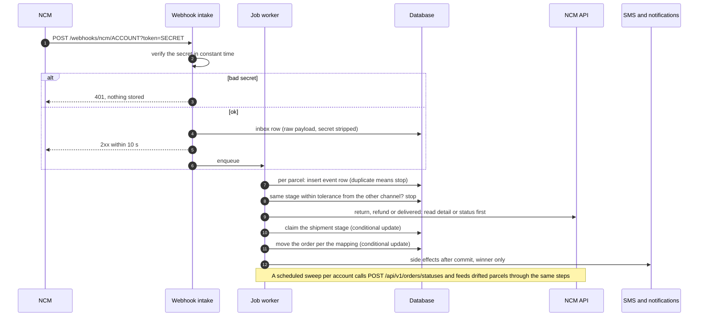

# Nepal Can Move (NCM) integration reference

A single-file reference for integrating the Nepal Can Move courier API into an
e-commerce or order-management project. It is generated from the Claude skill in
[`skills/ncm-integration/`](../skills/ncm-integration/SKILL.md); edit the files
under `skills/ncm-integration/references/` and run
`python3 scripts/build_reference.py`, never this file.

## Sources and labels

| Source | What it is |
|---|---|
| NCM API doc | *NCM API Documentation* PDF, file name dated `251222`, 18 pages, written against `https://demo.nepalcanmove.com` |
| NCM webhook doc | *NCM Webhook Integration Documentation* v1.1, "Last updated: September 2026", "Beta (subject to changes)" |
| A production integration | One multi-vendor platform's NCM integration, read in late 2026: its code, and its team's production checks |

Neither PDF is included here; ask NCM for current copies. Nothing in this
reference was checked against NCM's live API.

| Label | Meaning |
|---|---|
| **[doc]** | Stated in NCM's documents |
| **[inferred]** | Follows from the documents without being stated |
| **[observed]** | Seen in the production integration's code. Code shows what it *handles*, not what NCM *sends* |
| **[reported]** | Reported by that integration's team from production checks |
| **[recommended]** | A design rule for your project |
| **[unknown]** | Not settled by any source |

## Capability matrix

| Capability | NCM endpoint | Documented | Used by the production integration |
|---|---|---|---|
| Branch list | `GET /api/v2/branches` | yes (shape not given) | yes |
| Delivery charge | `GET /api/v1/shipping-rate` | yes (shape not given) | yes, always `type=Pickup/Collect` |
| Create order | `POST /api/v1/order/create` | yes | yes, one at a time, on confirmation |
| Order detail | `GET /api/v1/order?id=` | yes | yes |
| Order comments; last 25 comments | `GET /api/v1/order/comment?id=`; `GET /api/v1/order/getbulkcomments` | yes | yes |
| Status history; bulk status | `GET /api/v1/order/status?id=`; `POST /api/v1/orders/statuses` | yes | yes (reconciliation) |
| Post a comment | `POST /api/v1/comment` | yes | yes |
| Tickets: create, COD transfer, close | `POST /api/v2/vendor/ticket/create`, `…/ticket/cod/create`, `…/ticket/close/<id>` | yes | create and close (pickup requests); COD transfer unused |
| Staff list | `GET /api/v2/vendor/staffs` | yes | no |
| Return, exchange | `POST /api/v2/vendor/order/return`, `…/exchange-create` | yes | no |
| Redirect | `POST /api/v2/vendor/order/redirect` | yes | yes |
| Register webhook URL | `POST /api/v2/vendor/webhook` | named in the webhook doc only, parameters unknown | no |
| Status webhooks | 10 events | yes (v1.1) | 5 events; return and refund events were dropped (a mistake, see lessons) |
| `comment_added` webhook | — | no | yes |
| Redirectable list, customer ratings, ticket detail | `GET /api/v2/vendor/order/redirectable`, `GET /api/v2/vendor/ratings?phone=`, `GET /api/v1/tickets/<id>/detail` | no | yes |
| Cancel or hold an order | — | **not offered** | posts a comment instead |

## Recommended event flow [recommended]



## Discrepancies in NCM's own documents

| # | Topic | What the documents say |
|---|---|---|
| 1 | Webhook URL API | The webhook doc points to `POST /api/v2/vendor/webhook` "in the API documentation"; the API doc doesn't list it |
| 2 | Delivery-type names | The rate endpoint takes `Pickup/Collect`, `Send`, `D2B`, `B2B`; create takes `Door2Door`, `Branch2Door`, `Door2Branch`, `Branch2Branch`. The pairing is [inferred] from the rate table's descriptions |
| 3 | Branch list auth | Every other endpoint shows `Authorization: Token`; the branch list shows no header |
| 4 | Order detail fields | Five fields documented; live responses appear to carry more, such as `vendor_return` [reported] |
| 5 | Returns | After `rtv_delivery` the order reads `Delivered`, so a return ends looking like a delivery |
| 6 | Vendor spelling | The webhook label is `Send to Vendor`; the order's status is `Sent to Vendor` |
| 7 | Timestamps | Webhooks are UTC; the status API and the test webhook use `+05:45` |
| 8 | Bulk comments | Said to be newest first; the doc's own example isn't sorted |
| 9 | Pickup statuses | `Pickup Order Created` and `Sent for Pickup` appear in API examples but have no webhook event |
| 10 | Undocumented events | `comment_added` [observed] and `returned_to_warehouse` [reported] arrive but aren't listed |
| 11 | Redirect destination | Takes a branch **id**; create takes branch **names**; no documented source of branch ids |

## API contract

*Source: `skills/ncm-integration/references/api-contract.md`*

Nepal Can Move (NCM) is a courier in Nepal. This file is the public API contract
as NCM's own documents state it, plus a short, clearly marked list of behaviour
seen in one production integration but not in those documents.

**Sources**

- *NCM API Documentation* (PDF, file name dated `251222`, 18 pages). Called **API doc** below.
- *NCM Webhook Integration Documentation*, version 1.1, "Last updated: September 2026", status "Beta (subject to changes)". Called **Webhook doc**. Its contract is in [webhooks-and-statuses.md](../skills/ncm-integration/references/webhooks-and-statuses.md).

**Labels used**

- **[doc]** stated by NCM's documents. Example values below are adapted from the documents' examples, with ids, names and dates changed.
- **[inferred]** follows from the documents without being stated in them.
- **[observed]** seen in one production integration's code, not in NCM's documents. Code shows what the integration *handles*, not what NCM *sends*; confirm with NCM before you depend on it.
- **[reported]** that integration's team reports it from production checks; not visible in its code.
- **[unknown]** neither source settles it. Don't fill the gap with a guess.

### Basics

| Topic | Contract |
|---|---|
| Host | Every example uses `https://demo.nepalcanmove.com` [doc]. The production host is **not in the documents** [unknown]. Ask NCM, and make the base URL configuration, never a constant. |
| Auth | Header `Authorization: Token <api-token>` [doc]. "Every vendor is provided with an API Token Key"; a new or forgotten token comes from NCM's IT admin [doc]. |
| Token scope | One token per vendor (merchant) account [doc]. The integration's code assumes order ids are per-account sequences and that one account's token can't read another's orders [observed]; in one production check the platform token answered for none of 168 ids created under shops' own tokens [reported]. NCM's documents say neither. |
| Content type | `Content-Type: application/json` on POST examples [doc]. |
| Daily limits | "Order Creation : 200 per day"; "Order View (Detail, Comments, Status): 5000 per day" [doc]. Whether the limit is per token, when it resets, and what the response is when exceeded: [unknown]. |
| Conduct | "Avoid duplication of order creation from both bulk file upload and api system." "No Spamming or running scripts to overload the server." [doc] |
| Versioning | Paths mix `/api/v1/` and `/api/v2/` [doc]. No deprecation policy is documented [unknown]. |
| Pagination | Documented only for the staff list (`count`, `next`, `previous`, `results`) [doc]. |
| Sandbox | The documents are written against the demo host. Whether the demo shares data or tokens with production: [unknown]. |

### Errors

| Situation | Response [doc] |
|---|---|
| GET without a token | `401 {"detail": "Authentication credentials were not provided."}` |
| GET without `id` | `400 {"detail": "ID parameter missing"}` |
| GET with an unknown or invalid id | `404 {"detail": "Not found."}` |
| Server error | `500 {"detail": "Server Error"}` |
| Order create, bad fields | `400 {"Error": {"<field>": "<message>", ...}}` |
| Comment create, bad fields | `400 {"Error": {"Order Id": "...", "Comments": "..."}}` |
| Return, missing id | `400 {"message": "Order ID is required"}` |
| Return, unknown order | `404 {"message": "Order not found"}` |

Error bodies use three shapes: `detail`, `Error` (an object keyed by field) and `message`. Parse all three. The response to a rate limit (for example 429) is [unknown]. Expect HTML error pages from proxies as well, and never show a raw body to an end user.

### Endpoint catalog

Every endpoint takes `Authorization: Token <api-token>` unless the row says otherwise.

| # | Purpose | Method and path | Request | Success response [doc] |
|---|---|---|---|---|
| 1 | Branch list with details (phone, covered areas, district, region) | `GET /api/v2/branches` | none | Shape **not documented** [unknown]. The doc shows no auth header for this one; one integration sends none and gets branches [observed]. Branch **ids**, which the redirect endpoint needs, are documented nowhere else; that integration reads a `pk` field here [observed]. Test with a demo token. |
| 2 | Delivery charge between branches | `GET /api/v1/shipping-rate?creation=<from>&destination=<to>&type=<type>` | query `creation` (pickup branch), `destination` (destination branch), `type` (below). The doc's example uses branch **names** in capitals (`creation=TINKUNE&destination=POKHARA`) [doc]; whether ids or codes are accepted is [unknown]. | Shape **not documented** [unknown] |
| 3 | One order's detail | `GET /api/v1/order?id=<ncm-order-id>` | query `id` | `{"orderid", "cod_charge", "delivery_charge", "last_delivery_status", "payment_status"}` |
| 4 | One order's comments, newest first | `GET /api/v1/order/comment?id=<ncm-order-id>` | query `id` | array of `{"orderid", "comments", "addedBy", "added_time"}` |
| 5 | Last 25 comments across the account's orders | `GET /api/v1/order/getbulkcomments` | none | same item shape as #4 |
| 6 | One order's status history, newest first | `GET /api/v1/order/status?id=<ncm-order-id>` | query `id` | array of `{"orderid", "status", "added_time"}` |
| 7 | Create an order | `POST /api/v1/order/create` | JSON, see [Create an order](#create-an-order) | `200 {"Message": "Order Successfully Created", "orderid": <int>}` |
| 8 | Add a comment to an order | `POST /api/v1/comment` | `{"orderid", "comments"}`, both required | `200 {"message": "Comment successfully created"}` |
| 9 | Current status of many orders | `POST /api/v1/orders/statuses` | `{"orders": [<int>, ...]}` | `200 {"result": {"<id>": "<status>"}, "errors": [<id>, ...]}` |
| 10 | General support ticket | `POST /api/v2/vendor/ticket/create` | `{"ticket_type", "message"}`; `message` max 500 chars | `201 {"message": "Ticket created", "ticket": <int>}` |
| 11 | COD transfer request ticket | `POST /api/v2/vendor/ticket/cod/create` | `{"bankName", "bankAccountName", "bankAccountNumber"}`, all required | `201 {"message": "COD ticket created", "ticket": <int>}` |
| 12 | Close own ticket | `POST /api/v2/vendor/ticket/close/<ticket_id>` | ticket id in the path (`pk`) | `200 {"message": "Ticket closed", "ticket": <int>}` |
| 13 | Active staff list | `GET /api/v2/vendor/staffs?q=&page=&page_size=` (`limit` is an alias of `page_size`) | all optional; `page` default 1, `page_size` default 20 | `{"count", "next", "previous", "results": [{"id", "name", "email", "phone"}]}` |
| 14 | Mark an order for return | `POST /api/v2/vendor/order/return` | `{"pk": <order id>, "comment"?}` | `200 {"message": "Order marked for return successfully", "order": <int>, "vendor_return": true}` |
| 15 | Exchange (replacement plus pickup of the old item) | `POST /api/v2/vendor/order/exchange-create` | `{"pk": <original order id>}` | `200 {"message": "Exchange orders created", "cust_order": <int>, "ven_order": <int>}` |
| 16 | Redirect to another address or customer | `POST /api/v2/vendor/order/redirect` | see [Redirect](#redirect) | `200 {"message", "order", "cod_charge", "delivery_charge", "changelogs"}` |
| 17 | Set or remove the webhook URL | `POST /api/v2/vendor/webhook` | **not documented**: the webhook doc names it and says "see the NCM API documentation", but the API doc doesn't list it [unknown] | [unknown] |

Not offered by the documents: cancelling an order, creating an order on hold, labels or AWB printing, a pickup-request endpoint, a COD remittance or settlement statement, idempotency keys.

#### Delivery types

The rate endpoint and the create endpoint name the four services differently.
The rate table describes each `type` as Door2Door, Branch2Door, Door2Branch or
Branch2Branch, and the create endpoint uses those four words as its
`delivery_type` values. The doc never puts the two side by side, so the pairing
below is [inferred]; the names and charges in each row are [doc].

| Service | Rate `type` | Create `delivery_type` | Charge, as the rate table words it |
|---|---|---|---|
| NCM picks up from the sender and delivers to the door | `Pickup/Collect` | `Door2Door` (the default) | full base charge |
| Sender drops at a branch, NCM delivers to the door | `Send` | `Branch2Door` | full base charge |
| NCM picks up, customer collects at a branch | `D2B` | `Door2Branch` | base charge − 50 |
| Sender drops at a branch, customer collects at a branch | `B2B` | `Branch2Branch` | base charge − 50 |

"Base charge − 50" is the doc's wording; it gives no unit or base. Read the
charge from the rate endpoint; never compute it yourself. Keep one mapping table
in code, and don't send a rate `type` value to the create endpoint.

#### Create an order

`POST /api/v1/order/create` [doc]

| Field | Required | Meaning |
|---|---|---|
| `name` | yes | customer name |
| `phone` | yes | customer phone |
| `phone2` | no | secondary phone |
| `cod_charge` | yes | "cod amount including delivery": the cash NCM collects from the customer |
| `address` | yes | general address of the customer |
| `fbranch` | yes | **name** of the origin (from) branch |
| `branch` | yes | **name** of the destination branch |
| `package` | no | package name or type |
| `vref_id` | no | vendor reference id: your own order reference |
| `instruction` | no | delivery instruction |
| `delivery_type` | no | `Door2Door`, `Branch2Door`, `Branch2Branch`, `Door2Branch`; default `Door2Door` |
| `weight` | no | kg; default 1 |

The example sends every value as a JSON string, numbers included [doc]. Not documented [unknown]: field length limits, accepted phone formats, whether `cod_charge` may be `"0"` for a prepaid order, whether `vref_id` must be unique or is checked for duplicates, how `fbranch` relates to the account's own pickup branch.

Synthetic request:

```json
{
  "name": "Test Customer",
  "phone": "98XXXXXXXX",
  "phone2": "",
  "cod_charge": "1500",
  "address": "Example Tole, Ward 1",
  "fbranch": "<ORIGIN_BRANCH_NAME>",
  "branch": "<DESTINATION_BRANCH_NAME>",
  "package": "1 x Example item",
  "vref_id": "SHOP-ORDER-0001",
  "instruction": "Call before delivery",
  "delivery_type": "Door2Door",
  "weight": "1"
}
```

Success: `200 {"Message": "Order Successfully Created", "orderid": 1001}`. Note the capital `M` in `Message`. The `orderid` is the NCM order id every later call takes.

Failure: `400 {"Error": {"phone": "Invalid Phone Number", "branch": "Invalid Branch"}}`. The documented messages are `"Invalid COD Amount"`, `"Invalid Phone Number"`, `"Invalid Branch"`, `"Invalid Name"`, `"Invalid Address"`.

**No idempotency.** Nothing in the contract stops a retried create making a second parcel [doc: no such mechanism is described]. See [checklists.md](../skills/ncm-integration/references/checklists.md) for the claim-before-call pattern.

#### Order detail

`GET /api/v1/order?id=1001` → [doc]

```json
{
  "orderid": 1001,
  "cod_charge": "1500.00",
  "delivery_charge": "150.00",
  "last_delivery_status": "Delivered",
  "payment_status": "Completed"
}
```

- Money is a decimal **string** [doc]. Parse it as a decimal, never as a float.
- `payment_status` values other than `"Completed"`, and what `"Completed"` means (cash collected from the customer, or paid out to the vendor), are **not documented** [unknown]. Don't read it as "the vendor has been paid".
- One integration's parser also reads `vendor_return` (boolean: the parcel went back to the vendor rather than to the customer), `delivered_date`, `active` and a tracking id (`trackid`), none of them documented [observed]. Its production data holds NCM's `vendor_return` answers for many parcels, so that field at least is real [reported]; its return handling depends on it. The return endpoint's documented response also names a `vendor_return` flag [doc]. The other three are unverified. Confirm with NCM.

#### Status history and bulk status

`GET /api/v1/order/status?id=1001` returns newest first [doc]:

```json
[
  {"orderid": 1001, "status": "Delivered",            "added_time": "2026-01-02T13:24:30.960365+05:45"},
  {"orderid": 1001, "status": "Sent for Delivery",    "added_time": "2026-01-02T13:22:21.033595+05:45"},
  {"orderid": 1001, "status": "Pickup Complete",      "added_time": "2026-01-02T13:17:25.326792+05:45"},
  {"orderid": 1001, "status": "Sent for Pickup",      "added_time": "2026-01-02T13:15:24.313074+05:45"},
  {"orderid": 1001, "status": "Pickup Order Created", "added_time": "2025-12-30T11:32:18.149352+05:45"}
]
```

`added_time` carries a `+05:45` offset (Nepal) in the examples [doc]. Sort by the parsed time rather than trusting array order.

`POST /api/v1/orders/statuses` with `{"orders": [1001, 1002, 1003, 1004, 1005]}` [doc]:

```json
{
  "result": {"1001": "Pickup Order Created", "1002": "Arrived", "1004": "Drop off Order Created", "1005": "Delivered"},
  "errors": [1003]
}
```

- Ids go in as integers and come back as **string keys** [doc].
- `errors` lists ids NCM could not answer for. What causes an error entry is [unknown].
  - [observed] One integration found most of its long-stuck parcels listed here, while control parcels on the same token answered normally.
  - [reported] Ids created under another account's token went unanswered in one production check, so group ids by the token that created them.
- Maximum batch size: [unknown]. One integration uses 100.
- Whether a bulk call counts as one read or one per id against the 5,000 daily reads: [unknown].

#### Comments

`GET /api/v1/order/comment?id=1001` → newest first [doc]:

```json
[{"orderid": 1001, "comments": "Customer not reachable", "addedBy": "NCM Staff", "added_time": "2026-01-02T16:43:15.687200+05:45"}]
```

`addedBy` values seen in the doc: `"NCM Staff"`, `"Vendor"`. Comment ids are **not** in the documented response [doc]; one integration's code notes that the comment list "has not always included comment_id" and reads it when present [observed].

De-duplicate on (account, NCM order id, `comment_id`) when present, else on
(account, NCM order id, text, `addedBy`, `added_time`). Your own comments come
back with `addedBy: "Vendor"`; match them to the local comment by text within a
few minutes rather than storing them twice.

`GET /api/v1/order/getbulkcomments` returns the last 25 comments across the account's orders, "latest comments ... at the top" [doc]. The doc's own example is not strictly newest first, so sort locally. With only 25 rows, a busy account can lose comments between polls; use it as a supplement, not the only feed.

`POST /api/v1/comment` with `{"orderid": "1001", "comments": "Please call before 5pm"}` → `200 {"message": "Comment successfully created"}` [doc]. No comment id comes back [doc]. A length limit is [unknown].

**A comment post isn't idempotent.** After a timeout or a 5xx, NCM may already
have stored the comment. Before posting again, read the thread
(`GET /api/v1/order/comment?id=`) and look for the same text from `Vendor`.

#### Tickets

- `ticket_type` is one of `General`, `Order Processing`, `Return`, `Pickup` [doc].
- `message` is at most 500 characters [doc].
- A COD transfer ticket carries bank details: treat them as sensitive data, never log them, and confirm with the business who may file one.
- [observed] One integration also reads a ticket's detail with `GET /api/v1/tickets/<ticket_id>/detail`, which is not documented. Tickets closed on NCM's side are only seen that way.
- [observed] A "Pickup" ticket is how one integration asks NCM to collect parcels: a message giving the number of packets, the nearest branch, the address and a phone. There is no dedicated pickup endpoint [doc].

#### Return, exchange, redirect

**Return** `POST /api/v2/vendor/order/return` `{"pk": 1001, "comment": "Customer refused"}` [doc]:
- sets the order's `vendor_return` flag to `true`;
- with a comment, creates an external comment with status "Pending";
- only the vendor who owns the order may do it.

Record every return you request this way: the same `vendor_return` flag is what
a post-delivery check reads to detect a return NCM started.

**Exchange** `POST /api/v2/vendor/order/exchange-create` `{"pk": 1001}` [doc]: creates two orders, `cust_order` (a new delivery to the customer) and `ven_order` (the old item back to the vendor).

<a id="redirect"></a>**Redirect** `POST /api/v2/vendor/order/redirect` [doc]:

| Field | Required | Meaning |
|---|---|---|
| `pk` | yes | NCM order id |
| `name`, `phone`, `address` | yes | the new customer |
| `vendorOrderid` | no | your reference |
| `destination` | no | new destination **branch id** (an integer, unlike create, which takes branch names) [doc]. The only documented source of branch ids is this field's description; see endpoint #1 for where one integration gets them. |
| `cod_charge` | no | new COD amount (decimal) |

The response carries the new `cod_charge` and `delivery_charge` as strings, and `changelogs` as free text. A changed branch adds an `RDRT-DiFF-BRNCH` charge; the same branch adds a `REDIRECT` charge. A phone NCM doesn't know creates a customer record [doc]. Which orders may be redirected is [unknown] in the doc. [observed] One integration reads an undocumented `GET /api/v2/vendor/order/redirectable` list.

### Undocumented endpoints seen in production

[observed] One production integration calls these. They are not in the documents. Treat them as unstable, and confirm with NCM before use.

| Path | What the integration uses it for | Response shape it assumes |
|---|---|---|
| `GET /api/v2/vendor/order/redirectable` | which of the account's orders may be redirected now | paginated `{count, next, previous, results: [{orderid, branch, last_delivery_status}]}`, following `next` |
| `GET /api/v2/vendor/ratings?phone=<10 digits>` | a phone number's delivery history across NCM, for fraud checks before confirming an order | `{phone, total_orders, total_delivered, total_returned}`; a 404 means no history. This is personal data about a customer's other purchases: check with the business and NCM whether you may use it, and never log the phone. |
| `GET /api/v1/tickets/<ticket_id>/detail` | a ticket's status | a status under `status`, `ticket_status` or similar; the parser is deliberately loose |

The same integration retries an order-detail read when the error text matches "expected available in N seconds", which is Django REST framework's throttling wording [observed]. Whether NCM sends it, and with which HTTP status, is [unknown].

### What to ask NCM before go-live

1. The production base URL, and whether demo tokens and data are separate from production.
2. Rate-limit scope (per token?), reset time, and the response when it's exceeded.
3. Response shapes for `/api/v2/branches` and `/api/v1/shipping-rate`.
4. How to cancel an order, or hold one, after create. Neither is documented.
5. Maximum batch size for `/api/v1/orders/statuses`, and why an id lands in `errors`.
6. What `payment_status` values exist, and how COD remittance to the vendor is reported.
7. Whether `vref_id` is checked for duplicates.
8. Parameters for `POST /api/v2/vendor/webhook`.
9. The full list of order statuses and webhook events, including `comment_added`, `returned_to_warehouse`, and the maximum ids in one bulk event.
10. Whether undocumented fields (`vendor_return`, `delivered_date`, `active`, a tracking id) and endpoints (`/order/redirectable`, `/vendor/ratings`, `/tickets/<id>/detail`) are supported for vendors.
11. Whether a parcel can still be collected after you decide to cancel it, and how to stop that.
12. Whether webhooks for one parcel arrive in order.
13. Which characters names and addresses may contain (Devanagari?), and the length limits per field.
14. Whether a bulk status call counts once or per id against the daily reads.
15. How to rotate a webhook secret without losing events.
16. Whether `cod_charge: "0"` is accepted for a prepaid order, and what the rider then collects.
17. Where branch ids come from, since the branch list's shape is undocumented and the redirect's `destination` needs one.
18. Whether `Delivery Attempted`, `Out for Delivery` and `Dispatched to <BRANCH>` are real status strings, and what `returned_to_warehouse` means.
19. Whether posting a comment is idempotent in any way, since no comment id is returned.

## Webhooks, statuses and status processing

*Source: `skills/ncm-integration/references/webhooks-and-statuses.md`*

Labels:
- **[doc]** NCM's documents (webhook doc v1.1, Sept 2026, "Beta"; API doc PDF dated `251222`). Example values are adapted, with ids and dates changed.
- **[inferred]** follows from the documents without being stated in them.
- **[observed]** seen in one production integration's code, not in NCM's documents. Code shows what the integration *handles*, not what NCM *sends*; confirm with NCM.
- **[reported]** that integration's team reports it from production checks; it is not visible in its code.
- **[recommended]** a design rule for your project.
- **[unknown]** not settled by any source.

### The webhook contract [doc]

**Setup.** In the NCM vendor portal: API section (`/accounts/vendor/api`) →
"Webhook/API Callback URLs" → put your URL in **"Order Delivery Webhook URL"**
→ "Test Webhook" → "Add/Update". NCM also mentions setting or removing the URL
with `POST /api/v2/vendor/webhook`, whose parameters are [unknown].

**URL.** Valid HTTP or HTTPS; HTTPS recommended; may include query parameters.
NCM's own example is `https://your-domain.com/api/ncm-webhook?token=your-secret`.

**Request.** `POST` with headers `Content-Type: application/json`,
`Content-Length`, `User-Agent: NCM-Webhook/1.0`. Those are the only headers the
doc lists: **no signature, HMAC or timestamp header is documented** [doc].
NCM's security advice is "Consider using
query parameters or headers for authentication" [doc], and it documents no way
to configure a header, so a secret in the URL is what's available [inferred].

**Response.** Answer within **10 seconds** with **any 2xx**. Body content is
ignored.

**Delivery.** "No retry mechanism is currently implemented: a failed or
timed-out webhook is not sent again." Failures are handled silently on NCM's
side and don't affect the order. **A missed webhook is lost for good**, so you
need polling reconciliation (below).

**Scope.** "You only receive your own orders." When one NCM action covers
several vendors, each vendor gets a separate request with only its orders.

**Handling rules NCM gives.** Decide by `event`, not `status` ("status is a
display label"). Read both `order_id` and `order_ids`. Answer 2xx to events you
don't recognise, because new events may be added. Be ready for many requests
and for duplicates.

#### Events [doc]

| `event` | `status` label | Meaning | Payload |
|---|---|---|---|
| `pickup_completed` | Pickup Complete | picked up from you, received at the NCM branch | bulk |
| `dropoff_collected` | Drop off Order Collected | an order you dropped at a branch was received | bulk |
| `order_dispatched` | Dispatched | left its origin branch | bulk |
| `order_arrived` | Arrived | reached its destination branch | bulk |
| `sent_for_delivery` | Sent for Delivery | out for delivery | bulk |
| `delivery_completed` | Delivered | delivered | **single** |
| `order_marked_rtv` | Order Marked Return | marked for return to you | bulk (one order) |
| `send_to_vendor` | Send to Vendor | return on its way back with an NCM rider | bulk |
| `rtv_delivery` | RTV Delivered | return delivered back to you | bulk |
| `refund_initiated` | Refund Initiated | a refund was created | refund |

Notes [doc]:
- Transfers between intermediate branches send no event.
- **The webhook `status` can differ from the order's status in NCM.** After
  `send_to_vendor` the order reads `Sent to Vendor`; after `rtv_delivery` it
  reads **`Delivered`**.
- **The event list has no event for "Pickup Order Created" or "Sent for
  Pickup".** The status APIs show them.

Two more events arrive although the webhook doc doesn't list them:
- `comment_added` [observed]: the integration's code handles it, reading the order id from `order_id` or `order_ids` like any other event, plus `comment` (the text), `timestamp`, `comment_id` (optional) and `added_by` (optional, default "NCM"). No captured payload exists in that code, so this shape is reconstructed from its parser:

  ```json
  {"event": "comment_added", "order_id": "1001", "comment": "Customer asked for evening delivery", "comment_id": "501", "added_by": "NCM Staff", "timestamp": "2026-01-02T09:12:00.000000+00:00"}
  ```

  Its notes say NCM's portal has a separate **"Order Comment Webhook URL"**, which can point at the same receiver.
- `returned_to_warehouse` [reported]: its meaning and payload are [unknown].

#### Payloads [doc]

Single (`delivery_completed`):

```json
{"order_id": "1001", "status": "Delivered", "timestamp": "2026-01-02T07:39:30.960365+00:00", "event": "delivery_completed"}
```

Bulk (every other status event): `order_ids` holds one or more ids, **as strings**.

```json
{"order_ids": ["1001", "1002", "1003"], "status": "Dispatched", "timestamp": "2026-01-02T05:51:35.006775+00:00", "event": "order_dispatched"}
```

Refund (`refund_initiated`): a refund creates **two new NCM orders**, and both
are included.

```json
{
  "order_id": "1001",
  "status": "Refund Initiated",
  "customer_order": {"order_id": "1050", "cod_charge": "-1500.00", "delivery_charge": "150.00"},
  "refund_order":   {"order_id": "1051", "cod_charge": "1500.00",  "delivery_charge": "0.00"},
  "timestamp": "2026-01-03T11:47:01.123456+00:00",
  "event": "refund_initiated"
}
```

- `customer_order` returns the money to the customer; its `cod_charge` is the
  original COD **as a negative value**.
- `refund_order` brings the item back to you.
- Both then move like any other order, so their later events arrive too.
- `cod_charge` may be a string or `null`.

`timestamp` is "ISO 8601 timestamp in UTC" [doc]. The status API's
`added_time` uses a `+05:45` offset [doc]. Always parse to an instant, and
store and compare instants.

Test button payload (note the different shape, and its `+05:45` offset):

```json
{"event": "order.status.changed", "order_id": "TEST-123456", "status": "In Transit", "timestamp": "2026-01-02T15:30:00.000000+05:45", "test": true}
```

[recommended] Authenticate it like any other event, record it in the inbox as a
test, answer 2xx, and write nothing to orders.

### Status vocabulary

There is **no complete, published list** of NCM order statuses [unknown]. These
are every string the sources show.

| String | Where it appears | Notes |
|---|---|---|
| `Pickup Order Created` | status API example [doc] | The earliest row of the doc's status-history example. No webhook. |
| `Drop off Order Created` | bulk status example [doc] | Meaning [unknown]; the name suggests a branch drop-off order was created. No webhook. |
| `Sent for Pickup` | status API example [doc] | No webhook. NCM sets it for every new pickup parcel, whether or not the vendor has packed it [reported]. |
| `Pickup Complete` | status API [doc]; `pickup_completed` [doc] | |
| `Drop off Order Collected` | `dropoff_collected` [doc] | |
| `Dispatched` | `order_dispatched` [doc] | No API example shows it. One integration's poll map accepts `Dispatched to <BRANCH>`, per a code comment, with no captured payload [observed]. |
| `Arrived` | bulk status example; `order_arrived` [doc] | The same integration accepts `Arrived at <BRANCH>` [observed]. |
| `Sent for Delivery` | status API; `sent_for_delivery` [doc] | |
| `Out for Delivery` | one integration's status map [observed] | that integration's own name for the Sent for Delivery stage; its poll map accepts both; whether NCM sends it is unverified |
| `Delivered` | everywhere [doc] | **Also the final status of a return to the vendor** [doc]. |
| `Order Marked Return` | `order_marked_rtv` [doc] | webhook label |
| `Send to Vendor` / `Sent to Vendor` | webhook label vs the order's NCM status [doc] | two spellings for one stage |
| `RTV Delivered` | `rtv_delivery` [doc] | the order itself then reads `Delivered` |
| `Refund Initiated` | `refund_initiated` [doc] | |
| `In Transit` | test webhook only [doc] | |
| `Delivery Attempted` | one integration's status map [observed] | not in the documents; whether NCM sends it is unverified |
| `returned_to_warehouse` (event) | [reported] | not in the documents; meaning [unknown] |
| `Completed` | `payment_status` in the order detail [doc] | a payment field, not a delivery status |

[recommended] Match status strings case-insensitively after trimming and turning
`_`/`-` into spaces; match `Dispatched to …` and `Arrived at …` by prefix; and
log, never drop silently, any status you don't recognise.

### Keep four states apart

| State | Owned by | Changes when | Never infer it from |
|---|---|---|---|
| **Shipment state** (what NCM says about the parcel) | NCM | every webhook or poll | your order status |
| **Order state** (your business workflow) | your project | your rules decide, using shipment changes as inputs | a raw NCM string, copied blindly |
| **Payment state** (has the customer paid) | your project, plus a payment gateway or COD collection | prepayment, or NCM collecting the COD | `Delivered` alone |
| **Settlement state** (has the vendor been paid the collected COD) | NCM's remittance process, and your books | NCM transfers the money | `Delivered` or `payment_status: "Completed"`; no documented field confirms remittance [unknown] |

A **return** is a fifth concern. NCM ends a return-to-vendor as `Delivered`;
only the order detail's `vendor_return` flag [observed] or the RTV events
(`order_marked_rtv`, `send_to_vendor`, `rtv_delivery`) [doc] tell it apart.

### Mapping template [recommended]

Fill this in **with the user** for the destination project. Every row needs an
explicit decision; "copy NCM's string onto the order" is not one.

| NCM event or status | Shipment state to store | Order state change | Side effects to decide |
|---|---|---|---|
| `Pickup Order Created`, `Drop off Order Created` (poll only) | created | none (the parcel exists, which says nothing about packing) | none |
| `Sent for Pickup` (poll only) | awaiting pickup | none recommended: NCM sets it automatically | none |
| `pickup_completed`, `dropoff_collected` | collected | e.g. → "Shipped" | stock leaves the shop? customer SMS? |
| `order_dispatched` | in transit | optional | |
| `order_arrived` | at destination branch | optional | |
| `sent_for_delivery` | out for delivery | e.g. → "Out for delivery" | customer SMS? |
| `Delivery Attempted` (poll) [observed] | stays out for delivery; the attempt is recorded | none | staff alert? |
| `delivery_completed`, or `Delivered` from a poll, on a parcel **not** in a return stage | delivered | e.g. → "Delivered", **only if not a return**: no RTV event on record, and the order detail's `vendor_return` isn't true [observed field] | COD becomes *collectable*, not settled; the "delivered" message |
| `Delivered` from a poll on a parcel in a return stage (`return requested` or `return in transit`) | returned to vendor | as `rtv_delivery` | as `rtv_delivery`. NCM's order reads `Delivered` after `rtv_delivery` [doc], so this is how a return completes when the `rtv_delivery` webhook was lost |
| a return signal **after** delivered (`vendor_return` turns true, or a late RTV event) | returned | decide: move the order to returned, or alert staff | reverse the COD expectation; restock per D4; no "delivered" message was wrong, but the customer may need a word |
| `order_marked_rtv` | return requested | e.g. → "Returning" | staff alert |
| `send_to_vendor` | return in transit | | |
| `rtv_delivery` | returned to vendor | e.g. → "Returned" | restock? (a business decision) |
| `refund_initiated` | refund pending on the original; two **child shipments** (customer leg, refund leg) | the original order: refund pending; the legs' own events never move it | money moves back (who refunds a prepaid customer?); finance decision |
| `returned_to_warehouse` [reported] | record the raw event; no stage | none until NCM explains it | staff alert |
| `comment_added` [observed] | none | none | store the comment, notify staff |
| unknown event | record it | none | alert; answer 2xx |

If your own system calls `POST /api/v2/vendor/order/return`, record that you
did. The order detail's `vendor_return` then reads `true` [doc, from the
return endpoint's response], and your post-delivery check must not take it for
a return NCM started.

No cancel endpoint is documented [doc]. If an order is cancelled locally after
the parcel exists:
- decide how NCM is told (a ticket, a comment, the portal);
- keep polling that parcel;
- decide what happens if NCM collects it anyway. The order should stay cancelled, staff are alerted, and stock is reconciled, because the goods have left.

### Processing rules [recommended]

1. **Authenticate before you store anything.** Give each NCM account its own
   URL, with a **non-secret account id in the path** and a secret in the query.
   Two workable designs:
   - **Random secret per account**, stored hashed: `/webhooks/ncm/<account-id>?token=<secret>`. Intake looks the account up by id and compares in constant time. Rotation per account: store the new hash beside the old for a window, then drop the old. Needs the database at intake.
   - **Derived secret with a version in the path**: `/webhooks/ncm/<account-id>/<version>?token=HMAC(server_key, "<account-id>:<version>")`. Intake verifies with no database, so it keeps receiving while the database is down. The worker rejects a version older than the account's current one. Rotating one vendor's URL, or revoking a leaked one, means bumping its version and updating the URL in NCM's portal; `server_key` never changes for that.
   
   Either way, keep the query string out of access logs, and never queue the secret with the event.
2. **Acknowledge fast and durably.**
   - Persist the raw event (or enqueue it), answer 2xx, and process asynchronously. NCM allows 10 seconds and never retries.
   - An intake that runs separately from the main app keeps receiving during app downtime. Inside a monolith, a down app loses events, and reconciliation must catch up.
3. **Scope matching to the account.** NCM ids appear to be per-account sequences, so the same id may exist under two accounts [observed]. Match on `(account, ncm_order_id)`, never on the id alone, and record on each shipment which account created it.
4. **Process one parcel at a time** within a bulk event, each in its own
   transaction. `pickup_completed` arrives with up to about 100 ids, and one
   transaction over the whole batch timed out in production [reported].
5. **Make each status event idempotent.** Store every event with its raw label,
   a normalised **stage** (your own enum; the one used below is `created`,
   `awaiting_pickup`, `collected`, `in_transit`, `at_destination`,
   `out_for_delivery`, `delivery_attempted`, `delivered`, `return_requested`,
   `returning`, `returned`, plus `refund_pending` as a flag on the original
   parcel), its event time and its source (`webhook` or `poll`). An event you
   can't map gets no stage.
   - **Exact redelivery:** unique on `(account, ncm_order_id, source, raw label, event time)`. A clash means "already seen"; send no SMS, notification or stock change.
   - **Same transition from both channels:** webhook times and API `added_time` differ for one transition, and labels can differ too (`Sent for Delivery` vs `Out for Delivery`). Treat a poll row and a webhook row as the same transition when the stage matches and the times are within a tolerance. One integration uses 5 minutes [observed].
   - Side effects fire only when the **stage** changes.
6. **Never move backwards.** Rank the stages and apply forward moves only:
   - forward: `created` < `awaiting_pickup` < `collected` < `in_transit` < `at_destination` < `out_for_delivery` = `delivery_attempted` < `delivered`;
   - return branch, reachable from any forward stage including `delivered`: `return_requested` < `returning` < `returned`.
   
   A `Delivered` label read while the parcel is in `return_requested` or
   `returning` maps to `returned`, not `delivered`: NCM's order reads
   `Delivered` once a return reaches the vendor [doc]. Use the event time only
   to order events within one stage; it can't order stages, because NCM's real
   transitions can be closer together than the webhook-vs-API time difference.
   Compare **stages**, not raw labels, when deciding whether a poll result is
   news, or a benign label difference will re-fetch history every run.
7. **Claim the shipment's stage** with a conditional update
   (`UPDATE shipment SET stage = <new> WHERE id = ? AND stage = <old>`) and
   check the row count. Side effects belong to the winner of that claim: the
   other channel, arriving a moment later, records its event and stops. In the
   same transaction, move the order with its own conditional update on the
   status you read. Losing either claim means someone else moved it: no side
   effects.
8. **Protect statuses staff set on purpose** (cancelled, on hold) and final
   ones (returned) from courier overwrites. Record the courier status on the
   shipment and alert staff instead.
   - `Delivered` is final for forward events.
   - A **return signal** (an RTV event, or `vendor_return` turning true) may still follow it. Handle that as the "return after delivered" row of the mapping, never by ignoring it.
9. **Treat `Delivered` carefully.** Before you mark the order delivered or text
   the customer, check for a return: the parcel's stage (rule 6), an RTV event
   on record, or the order detail's `vendor_return` [observed] read at that
   moment. If that read fails, don't send the delivered message: retry the
   read, or hold the delivered transition for a person. A return you requested
   yourself (`POST /api/v2/vendor/order/return`) must be on record, so its
   `vendor_return: true` isn't taken for a return NCM started.
10. **Confirm high-impact events with an API read.** A webhook carries no
    signature [doc], so read `GET /api/v1/order/status?id=` or the order detail
    before restocking, refunding, or changing money owed.
11. **Run side effects after commit:** live UI events, notifications and SMS.
    Each failure is isolated and logged; none of them may roll back the status.
12. **Unknown events and statuses:** record them, answer 2xx, alert, and change no
    order.
13. **Missing or unreadable `timestamp`:** use the receive time, and mark the event
    as such, so it never outranks a real NCM time.
14. **Unmatched ids:** record which ids matched no shipment. They may belong to
    another account, to orders created outside your system (the portal or bulk
    upload), or to a misconfigured secret. Count them on a dashboard.
15. **Don't replay old events** from your job system's failure store until
    rules 5–9 exist. Without them, a replay moves orders backwards and
    texts customers again.
16. **Keep an inbox.** One row per received webhook: source, raw payload (with
    personal data minimised), outcome (`processed`, `partial`, `no_match`,
    `invalid`, `unknown_event`, `test`, `error`), unmatched ids, error text. That
    row is how operators answer "did NCM tell us?".

### Reconciliation, because webhooks are never retried [recommended]

- **Scheduled sweep.** Every few hours, take parcels that are not finished and
  not checked recently, grouped **per account token**. Include parcels whose
  order was cancelled locally: NCM may still move them. Call
  `POST /api/v1/orders/statuses` in batches. Map each answer to a stage; only
  for parcels whose **stage** differs from the stored one (or doesn't map),
  fetch `GET /api/v1/order/status?id=` for the timestamps, and apply the newest
  entry through **the same transition function** as the webhook. Remember
  that `Delivered` on a parcel in a return stage means `returned` (rule 6).
- **Ids under `errors`, or missing from `result`:** don't mark them "checked and
  fine". NCM gave no status for them, for a reason the docs don't explain. Make
  a per-order status call; if that answers 404 "Not found.", flag the parcel for
  a person.
- **Post-delivery return check.** A return can show only as `vendor_return`
  flipping after `Delivered` [observed]. Re-check recent deliveries' order detail
  for a while, and apply a hit as the mapping's "return after delivered" row.
- **Budget the calls.** The status APIs count against 5,000 reads a day [doc].
  Whether a bulk call costs one read or one per id is [unknown]; assume per id
  until NCM says otherwise. Size the sweep (batch size, staleness window,
  look-back days) so it fits with room for manual refreshes.
- **Manual refresh.** One button per order that runs the same per-order sync,
  for support staff.

## Decisions, implementation and testing checklists

*Source: `skills/ncm-integration/references/checklists.md`*

Framework-neutral. "Job" means whatever background-work mechanism the project
has (a queue, a cron runner, a job table), and "failure store" means where it
keeps failed jobs (a dead-letter queue, a failed-jobs table). "Transaction"
means the project's database transaction. Contract details are in [api-contract.md](../skills/ncm-integration/references/api-contract.md)
and [webhooks-and-statuses.md](../skills/ncm-integration/references/webhooks-and-statuses.md).

### Decisions to settle with the user first

Ask these before writing code. Each changes the data model or money.

| # | Decision | Why it can't be guessed |
|---|---|---|
| D1 | **Whose NCM account?** One platform account, each vendor's own, or both. | NCM ids are per account; matching, polling and webhook secrets all depend on it. |
| D2 | **When is the parcel created?** On confirm, on "ready to ship", or by a person clicking. | NCM has no hold and no cancel endpoint; a created parcel may be collected. |
| D3 | **Cancellation after creation.** How is NCM told (ticket, comment, portal by hand)? What if NCM collects it anyway? | No cancel endpoint is documented. |
| D4 | **Returns.** Which events move the order; does a return restock automatically or wait for staff; how is a `Delivered` that is really a return handled? | NCM ends a return as `Delivered`. |
| D5 | **COD amount.** What goes in `cod_charge` for prepaid, partly paid and discounted orders; is the delivery charge added? | NCM defines it as "cod amount including delivery". Whether `"0"` is accepted for a prepaid order is undocumented. |
| D6 | **COD settlement.** What proves the vendor was paid, who reconciles NCM's remittance, is `Delivered` "collectable" or "paid", and do vendors on their own NCM account settle with NCM directly? | NCM documents a COD-transfer *request* ticket (bank details), but no remittance statement or settlement field. |
| D7 | **Inventory.** Which courier states, if any, move stock; does a courier status ever override a staff decision? | Stock bugs are expensive and silent. |
| D8 | **Customer messages.** Which courier events text or email the customer, and never twice. | Duplicate and out-of-order webhooks happen. |
| D9 | **Status mapping.** Fill in the template in webhooks-and-statuses.md for the project's real order states. | The project's states are its own. |
| D10 | **Branches and rates.** Live NCM calls, a cached copy, or a stored table; refresh schedule; how the destination branch is chosen (from the address, a map pin, or staff); the shop's pickup branch. | Response shapes for both endpoints are undocumented; rates are quoted by branch name; branch ids (needed to redirect) come only from the undocumented branch list. |
| D11 | **Pickup requests.** How NCM is asked to collect: a `Pickup` ticket by hand or on a schedule, or arranged outside the system; how you avoid filing two while one is open. | NCM has no pickup endpoint, and documents no way to tell you a ticket was closed. |

### Implementation order

Each step ends with a checkpoint. Don't start the next step until it passes.

1. **Configuration and secrets**
   - Base URL and token per account from configuration or encrypted storage; demo and production kept apart, and the app refuses to start a production environment on the demo host.
   - A webhook URL per account: a non-secret account id in the path and a secret in the query. Prefer `HMAC(server_key, account_id)` as the secret, so intake can verify it without a database.
   - Secret rotation that accepts the old and the new secret for a window. The query string kept out of access logs.
   - A refusal at startup if the encryption key is missing, rather than a fallback key.
   - *Checkpoint:* a unit test proves the right token is chosen for each account, and that no token appears in logs or API responses.
2. **One NCM HTTP client**
   - Sets the auth header and per-call timeouts.
   - Parses all three error shapes (`detail`, `Error`, `message`) and HTML bodies.
   - Maps failures to safe messages, and counts calls against the daily limits.
   - *Checkpoint:* contract tests against recorded **synthetic** responses for every endpoint you use, including 400, 401, 404, 500 and a timeout.
3. **Data model**
   - A shipment with: the local order, the **account**, the NCM order id, a `kind` (primary, refund customer leg, refund return leg, exchange legs), a parent shipment for legs, delivery type, origin and destination branch, COD amount, delivery charge, NCM stage and raw status, its time, last checked time, return flag, and a needs-attention flag.
   - Unique `(account, ncm_order_id)`, and at most one active **primary** shipment per order.
   - A status-event table storing the raw label, normalised stage, event time and source. Unique on `(account, ncm_order_id, source, raw label, event time)`, plus the cross-channel tolerance rule ([webhooks-and-statuses.md, processing rule 5](../skills/ncm-integration/references/webhooks-and-statuses.md#processing-rules-recommended)).
   - A webhook inbox table.
   - *Checkpoint:* the migration runs on a copy; the unique keys reject duplicates.
4. **Branches and rates**
   - Fetch, validate the shape you actually receive, cache with a time to live, and degrade clearly when NCM is down.
   - Keep the rate `type` ↔ create `delivery_type` mapping in one place.
   - *Checkpoint:* the order form shows a price for each delivery type, or an explicit "unavailable".
5. **Create the parcel**
   - **Claim first:** in a transaction, insert the shipment row in a `submitting` state. The guard is the partial unique index "one active primary shipment per order" (`ncm_order_id` is still empty here, so the `(account, ncm_order_id)` key can't be the guard).
   - Call NCM outside the transaction, with `vref_id` set to your order reference.
   - On success, store `orderid` and move to `created`.
   - On a clear 400, store the field errors and release the claim.
   - On a timeout or 5xx, mark it `unknown` for a person to check in NCM's portal. The API can't look a parcel up by `vref_id`. Never retry automatically: the create may have succeeded.
   - A sweeper turns `submitting` rows older than the create timeout plus a margin (a crashed worker) into `unknown`.
   - Make `vref_id` unique across every vendor on a shared account, for example `<store>-<order>`.
   - Validate what you know: required fields present, phone digits in your country's format, branch names from the cached list, COD as a non-negative decimal string. NCM's own field limits are undocumented, so keep any length limits configurable and confirm them with NCM.
   - *Checkpoint:* tests for success, 400, timeout, a double click and two workers racing. Each ends with at most one NCM create call per order.
6. **Webhook receiver**
   - Authenticate the URL secret before storing anything.
   - Write the inbox row and answer 2xx within NCM's 10 seconds; hand off to a job.
   - A `test: true` event is authenticated, recorded as a test, and answered 2xx, with no order writes.
   - *Checkpoint:* the NCM portal's "Test Webhook" reaches you and is recorded as a test.
7. **Status processing (one function for webhook and poll)**
   - Per parcel, in its own transaction:
     1. insert the event row; a unique-key clash is an exact redelivery: stop;
     2. look for a recorded event of the same stage within the tolerance; a hit is the other channel's copy: stop;
     3. compare the stage rank (forward only, except returns; `Delivered` in a return stage is `returned`);
     4. claim the shipment's stage with a conditional update; a lost claim means stop;
     5. decide the order move from the mapping and apply it with a conditional update on the order's status;
     6. queue side effects after commit, for the winner only.
   - Confirm return, refund and money events with an API read first.
   - *Checkpoint:* every row of the testing checklist below passes.
8. **Reconciliation**
   - A scheduled sweep per account using bulk status, then per-order history for drift. It includes parcels of locally cancelled orders.
   - A post-delivery return check.
   - Ids NCM doesn't recognise are flagged, not silently stamped "checked".
   - A manual refresh button.
   - *Checkpoint:* with webhooks switched off, a parcel still reaches its true status within one sweep window.
9. **Pickup requests, comments, tickets, redirect, return, exchange** (only those the user wants)
   - Pickup requests per D11. Claim the request locally (unique per account and slot) before filing the ticket.
   - Outbound comments through a job serialized **per account**, not globally.
     - Retry automatically only when the request clearly never reached NCM (connection refused, DNS failure).
     - After a timeout or 5xx, read the order's thread and look for the text before posting again: a comment post isn't idempotent.
     - Failures go to the job system's failure store (a dead-letter queue or a failed-jobs table).
   - Inbound comments from `comment_added` [observed], plus a periodic poll. De-duplicate on (account, NCM order id, `comment_id`) when present, else (account, NCM order id, text, author, `added_time`). Match your own echoed comments by text within a few minutes.
   - Redirects and returns: claim locally, call NCM, then record, as for create.
   - *Checkpoint:* a comment round-trips once, never twice.
10. **Operations**
    - Dashboards for: webhook outcomes by type, unmatched ids, unknown events and statuses, parcels with no status change for N days, parcels NCM doesn't recognise, cancelled orders NCM still moves, `unknown` creates, the daily API budget, and failed jobs.
    - A runbook for each.
    - *Checkpoint:* a person can answer "why is order X stuck?" from the dashboard and the inbox without reading code.

### Testing checklist

Use synthetic ids, names and phones only.

**Happy paths**
- [ ] A create with each `delivery_type` sends the right fields; the NCM `orderid` is stored.
- [ ] `pickup_completed` → `order_dispatched` → `order_arrived` → `sent_for_delivery` → `delivery_completed` moves the order exactly as the mapping says, with one customer message per mapped event.
- [ ] A bulk event with 100 ids updates all 100 parcels.
- [ ] A comment from NCM appears once; a comment to NCM is sent once.

**Failures**
- [ ] A create times out → no automatic retry; the shipment is `unknown`; a person can resolve it.
- [ ] A create is accepted by NCM, then the local commit fails → the shipment is left `unknown`; a person finds the parcel in NCM's portal and links it; the runbook covers it.
- [ ] A worker crashes mid-create → the sweeper turns the stale `submitting` row into `unknown`.
- [ ] NCM answers 400 with field errors → the user sees a safe, field-level message, never the raw body.
- [ ] NCM answers 401, 404, 500 or HTML → handled, logged without secrets.
- [ ] The database is down while a webhook arrives → intake still verifies it (HMAC secret) and queues it, or, if intake needs the database, the reconcile recovers the status later.
- [ ] A detail read fails while processing `delivery_completed` → no delivered message goes out; the read is retried or the transition is held for a person. For other stages the update applies and the read is retried later. Nothing is half-applied.

**Duplicates and ordering**
- [ ] The same webhook twice → one history row, one order move, no second SMS or notification.
- [ ] `sent_for_delivery` arrives after `delivery_completed` → history records it; the order stays delivered.
- [ ] A poll applies a status the webhook already applied, with a different time and label (`Out for Delivery` vs `Sent for Delivery`) → no change, no side effects.
- [ ] A replayed old event from the failure store → history only; the order doesn't move back.
- [ ] The webhook and the poll apply the same transition at the same moment, with different labels and times, and no order move is configured for it → exactly one wins the shipment-stage claim, and only it sends the side effect.
- [ ] `order_marked_rtv` and `send_to_vendor` arrive, the `rtv_delivery` webhook is lost, and the next sweep reads `Delivered` → the parcel becomes returned, the order follows D4, and no "delivered" message goes out.
- [ ] Staff change the order while a webhook is processing → staff win; the courier status is kept on the shipment only.

**State protection**
- [ ] A cancelled order receives `pickup_completed` → the order stays cancelled; staff are alerted.
- [ ] A return (`rtv_delivery`, or `vendor_return: true` with `Delivered`) never produces a "delivered" message to the customer, and follows the return decision (D4).
- [ ] `vendor_return` turns true days after a normal delivery → handled as "return after delivered" (D4).
- [ ] `refund_initiated` → two child shipments; their later events never move the original order.
- [ ] A forged webhook with a valid-looking body but a wrong secret → rejected; a return or refund event is confirmed with an API read before stock or money moves.
- [ ] An unknown event and an unknown status → recorded, answered 2xx, order unchanged, alert raised.
- [ ] `Sent for Pickup` from a poll doesn't change the order (if that's the decision).

**Tenant isolation**
- [ ] Two accounts with the same NCM order id → each event updates only its own account's shipment.
- [ ] An unknown or empty secret → rejected before anything is stored.
- [ ] A vendor's own-account secret can't update another vendor's or the platform's orders.
- [ ] Switching a vendor between its own account and the platform account doesn't strand parcels already in transit.

**Partial bulk failures**
- [ ] A bulk event where one parcel's transaction fails → the others are saved; the failed one is retried alone; no duplicate side effects for the saved ones.
- [ ] A bulk event with unmatched ids → matched ones are processed; unmatched ones are recorded for an operator.
- [ ] A bulk status call returns some ids under `errors` → those are flagged, not marked healthy.

**Limits**
- [ ] The reconciliation run stays within its share of 5,000 reads a day for the expected fleet size.
- [ ] A rate-limit or throttling response (shape unknown) backs off instead of hammering NCM.

## Lessons from a production integration

*Source: `skills/ncm-integration/references/production-lessons.md`*

How one multi-vendor e-commerce platform in Nepal (a web app, a Postgres
database, a queue worker and a separate serverless webhook receiver) integrates
NCM. This file is about **behaviour**, not that stack: use the patterns, not the
technology. Each item says whether to copy it.

The numbers marked *reported* come from that team's own production
investigation (aggregate counts, late 2026). They weren't independently checked;
use them to size things, not as facts about NCM.

### Patterns worth copying

| Pattern | What it does |
|---|---|
| **Receiver → queue → worker** | A tiny public endpoint queues the raw webhook and answers 200 at once; a worker processes it. It survives app downtime and stays inside NCM's 10-second limit. |
| **Webhook inbox** | One row per received webhook with the raw payload, outcome (`PROCESSED`, `PARTIAL_MATCH`, `NO_MATCH`, `INVALID`, `MISSING_FIELDS`, `UNKNOWN_EVENT`, `TEST`, `ERROR`), the ids that matched nothing, and the error. Operators answer "did NCM tell us?" from it. Kept for 90 days (processed) or 180 days (anomalies). |
| **Per-account webhook secrets** | The platform account has one secret; each vendor with its own NCM account gets a random token in its webhook URL. The token decides which account's parcels an event may touch. |
| **Account-scoped matching** | Ids are matched only among that account's shipments. The integration's code treats NCM ids as per-account sequences, so the same id can exist under two accounts. Not documented by NCM. |
| **Bulk-then-detail reconcile** | Every 3 hours: stale, unfinished parcels, grouped per account token, checked with `POST /api/v1/orders/statuses` in batches of 100. Only drifted ones fetch full history and are healed through the webhook's code path. An in-sync fleet costs a few calls. |
| **Post-delivery return sweep** | Recently delivered parcels are re-read from the order detail, because `vendor_return` can flip to true after `Delivered`. |
| **History backfill with real times** | A poll inserts the missing status-history rows with NCM's own `added_time`, de-duplicated against webhook rows within 5 minutes, because webhook and API times differ. |
| **Manual refresh per order** | Support staff can pull one parcel's history on demand. |
| **Outbound comments through a queue** | Saved locally as `queued`, sent by a worker, marked `sent`, `retrying` or `failed`; a job already `sent` is never sent again. Copy the state machine, not the details: they serialized **all** vendors in one group (#19 below), and retried timeouts, which can post twice. |
| **Comment de-duplication** | Key on (NCM order id, comment id) when present, else (NCM order id, text, author, time). The vendor's own comment echoed back by NCM is matched to the local one within ±5 minutes. Add the account to the key if you have several. |
| **Write once, with an override** | `deliveredDate` and the first time a return was confirmed are written once, and a missing `vendor_return` answer never clears a stored one. Keep a staff override, or a wrong answer is permanent. |
| **Claim before calling, for scheduled pickup tickets** | The scheduler inserts a run row, unique per shop and slot, *before* calling NCM, so two schedulers never file twice. Apply the same idea to parcel creation (they didn't). |

### Business decisions they made (not patterns)

These are choices, not practices to copy. Your project decides its own, with the user.

- Vendors on the platform's NCM account are paid their COD by the platform, after an admin approves a payout; vendors on their own NCM account are treated as settling COD with NCM directly and can't request payouts.
- The parcel is created when the order is confirmed, by staff or by an auto-confirm job.
- "Packed" means a label was printed or staff marked it, never an NCM pickup status.
- Returns update the order automatically (proposed), but restocking stays with staff.

### Numbers they used

Starting points, not NCM's limits [observed].

| Setting | Value |
|---|---|
| Timeouts | create 15 s; order detail 10 s; status history 10 s; bulk status 15 s; rate 10 s; branches 20 s; comment, ticket, redirect 15 s |
| Reconcile | every 3 hours; parcels created in the last 45 days; a parcel at most once per 3.5 hours; 500 per run; bulk calls of 100 ids, 200 ms apart; up to 200 post-delivery return re-checks per run |
| Cross-channel tolerance | a poll row within 5 minutes of a webhook row of the same status counts as the same transition |
| Rate cache | 12 hours per route and account |
| Create payload | `phone` = last 10 digits; `weight` always `"1"`; `package` = "N item(s)"; `vref_id` = the shop's order number; `instruction` capped at 100 characters |
| Inbox retention | processed and test receipts 90 days, everything else 180 |
| Webhook queue | 10 messages per receive, 60 s visibility, redrive to a dead-letter queue after 5 receives, 14-day retention |

### Behaviour not to copy

| # | What they did | What went wrong | Do instead |
|---|---|---|---|
| 1 | One database transaction for every parcel in a bulk webhook | `pickup_completed` batches of ~80–100 ids timed out ("expired transaction") and the whole message failed (*reported*: 10 messages, ~82 ids each). | One transaction per parcel. |
| 2 | Copied NCM's status onto the order whenever it differed, with no guard | Cancelled, on-hold, staff-delivered and returned orders were overwritten. | A transition rule that protects staff-held and terminal states. |
| 3 | Polled `Pickup Order Created` and `Sent for Pickup` onto the order | NCM sets these for every new parcel, packed or not, so confirmed orders moved on their own (*reported*: 341 of 1,629 parcels in 60 days). | Record them on the shipment only. |
| 4 | No ordering check at all | A late or replayed older event could move an order backwards and text the customer again. | Rank the stages and apply forward moves only; use the event time only within a stage. |
| 5 | `UPDATE … WHERE id = ?` for the order | Overwrote a staff change made a moment earlier. | A conditional update on the status read, with the row count checked. |
| 6 | Called NCM's create **before** claiming the order | Two confirms racing, a local failure after NCM accepted, or a timeout each produced duplicate or orphan parcels; the only trace was a log line. | Claim, call, record; `unknown` on a timeout; never auto-retry a create. |
| 7 | Didn't store which NCM account created each parcel | Switching a vendor between its own account and the platform's stranded parcels in transit: their webhooks matched nothing, and polls used the wrong token. | Store the account on the shipment and always use it. |
| 8 | The receiver only checked that `?token=` was present, stored the event before checking the token, and put the token in the queued message | Anyone could fill the inbox and the queue; the secret spread into queue messages. | Verify the secret in constant time at the edge; strip it before queueing. |
| 9 | Two webhook entry points (a direct route and the queue) | They drifted: only one handled comments; one returned internal error text. | One entry point, one processing function. |
| 10 | Dropped the RTV and refund events; relied on `vendor_return` | Returns showed as `Delivered`, and customers got "delivered" texts for returned parcels (*reported*: 158 orders). | Handle `order_marked_rtv`, `send_to_vendor`, `rtv_delivery`, `refund_initiated`; check returns before "delivered". |
| 11 | Treated `Delivered` as "COD owed to the vendor"; "paid" was a manual admin click | Nothing confirmed NCM's remittance; balances included orders with no NCM parcel; payout checks re-read **every** delivered order, spending the read quota. | Model collected, remitted and paid separately; agree the evidence for each. |
| 12 | Stamped parcels missing from bulk results as "checked" | Parcels NCM no longer recognised sat unseen for weeks (*reported*: 388 of 391 parcels stuck on `Sent for Pickup` were unknown to NCM). | Flag them for a person after a confirming per-order lookup. |
| 13 | Reconciled only parcels under 45 days old, and skipped cancelled orders | Old stuck parcels, and parcels NCM collected after a local cancel, were never seen again. | Keep a long-tail check, and alert on cancelled orders NCM still moves. |
| 14 | Quoted every rate with `type=Pickup/Collect`, whatever `delivery_type` was created | Branch-drop or branch-collect orders were priced as door-to-door. | Map the four services between the two vocabularies. |
| 15 | Guessed "prepaid" from free-form checkout fields | A partly prepaid COD order was sent with `cod_charge: "0"`, while another path sent the full amount. | Store the payment method and the amount due. |
| 16 | Stripped every non-ASCII character from names and addresses | Devanagari names and addresses arrived blank. | Ask NCM what it accepts before discarding text. |
| 17 | Returned NCM's raw error body (sometimes HTML) to the browser, and logged full create payloads with names, phones and addresses | Leaked internals and personal data. | Safe messages to users; ids and outcomes in logs. |
| 18 | Left some routes that call NCM with platform credentials unauthenticated | Anyone could create parcels or spend the platform's daily quota. | Every route that calls NCM needs auth and a permission. |
| 19 | Every vendor's outbound comments serialized in one global line | One failing comment blocked every vendor for up to 15 minutes per retry. | Serialize per account (a per-account lock or queue key), never globally. |
| 20 | Cancelling sent only the comment "Order cancelled." | Nobody knows whether NCM acts on it; the reconcile then stopped looking at the order. | Agree a cancel procedure with NCM, and keep watching cancelled parcels. |
| 21 | A ticket closed on NCM's side stayed open locally | It blocked new pickup tickets until someone closed it by hand. | Sync ticket status, or expire the local guard. |
| 22 | The branch sync only upserted | Branches NCM retired stayed selectable. | Deactivate branches missing from a successful full sync. |
| 23 | Sent the shop's own order number as `vref_id` | Two shops on the shared platform account can send the same reference. | Make it unique per account. |
| 24 | Called NCM's redirect **before** the local transaction | A lost race rolled back locally after NCM had already redirected the parcel. | Claim first, for every NCM write. |
| 25 | Kept failed webhook messages in a dead-letter queue with no ordering guard | Without that guard, replaying them can move orders backwards and text customers again. | Build the ordering and state rules before relying on replay. |
| 26 | No tests for the webhook, sync or reconcile functions | Every bug above shipped. | Start with the testing checklist. |

### Things they learned about NCM

These were learned in production, and NCM's documents don't confirm them.
Confirm them with NCM.

- `comment_added` webhooks arrive and are handled in code. `returned_to_warehouse` arrives too (*reported*). The webhook doc lists neither.
- NCM's portal has a separate "Order Comment Webhook URL", per the integration's own notes.
- The order detail carries `vendor_return`, `delivered_date`, `active` and a tracking id.
- Its status map expects branch names embedded in statuses (`Dispatched to <BRANCH>`, `Arrived at <BRANCH>`) and the strings `Delivery Attempted` and `Out for Delivery`. Whether NCM sends them wasn't verified from a captured response.
- Webhook and API timestamps for the same transition differ; the integration treats rows within 5 minutes of each other as the same transition.
- A bulk status call can put many ids under `errors` while control parcels on the same token answer normally (*reported*).
