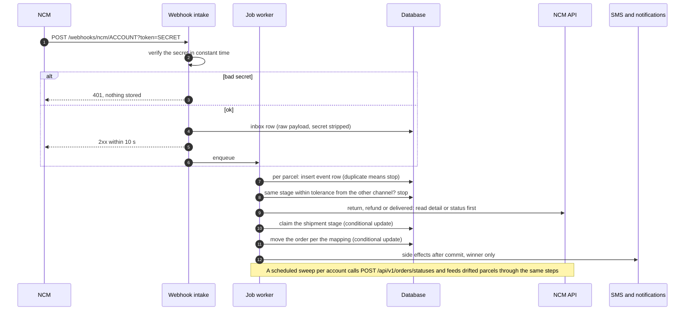

# Nepal Can Move (NCM) integration reference

A single-file reference for integrating the Nepal Can Move courier API into an
e-commerce or order-management project. It is generated from the Claude skill in
[`skills/ncm-integration/`](../skills/ncm-integration/SKILL.md); edit the files
under `skills/ncm-integration/references/` and run
`python3 scripts/build_reference.py`, never this file.

## Sources and labels

| Source | What it is |
|---|---|
| NCM API doc | *NCM API Documentation* PDF, file name dated `251222`, 18 pages, written against `https://demo.nepalcanmove.com` |
| NCM webhook doc | *NCM Webhook Integration Documentation* v1.1, "Last updated: September 2026", "Beta (subject to changes)" |
| A production integration | One multi-vendor platform's NCM integration, read in late 2026: its code, and its team's production checks |

Neither PDF is included here; ask NCM for current copies. Nothing in this
reference was checked against NCM's live API.

| Label | Meaning |
|---|---|
| **[doc]** | Stated in NCM's documents |
| **[inferred]** | Follows from the documents without being stated |
| **[observed]** | Seen in the production integration's code. Code shows what it *handles*, not what NCM *sends* |
| **[reported]** | Reported by that integration's team from production checks |
| **[recommended]** | A design rule for your project |
| **[unknown]** | Not settled by any source |

## Capability matrix

| Capability | NCM endpoint | Documented | Used by the production integration |
|---|---|---|---|
| Branch list | `GET /api/v2/branches` | yes (shape not given) | yes |
| Delivery charge | `GET /api/v1/shipping-rate` | yes (shape not given) | yes, always `type=Pickup/Collect` |
| Create order | `POST /api/v1/order/create` | yes | yes, one at a time, on confirmation |
| Order detail | `GET /api/v1/order?id=` | yes | yes |
| Order comments; last 25 comments | `GET /api/v1/order/comment?id=`; `GET /api/v1/order/getbulkcomments` | yes | yes |
| Status history; bulk status | `GET /api/v1/order/status?id=`; `POST /api/v1/orders/statuses` | yes | yes (reconciliation) |
| Post a comment | `POST /api/v1/comment` | yes | yes |
| Tickets: create, COD transfer, close | `POST /api/v2/vendor/ticket/create`, `…/ticket/cod/create`, `…/ticket/close/<id>` | yes | create and close (pickup requests); COD transfer unused |
| Staff list | `GET /api/v2/vendor/staffs` | yes | no |
| Return, exchange | `POST /api/v2/vendor/order/return`, `…/exchange-create` | yes | no |
| Redirect | `POST /api/v2/vendor/order/redirect` | yes | yes |
| Register webhook URL | `POST /api/v2/vendor/webhook` | named in the webhook doc only, parameters unknown | no |
| Status webhooks | 10 events | yes (v1.1) | 5 events; return and refund events were dropped (a mistake, see lessons) |
| `comment_added` webhook | — | no | yes |
| Redirectable list, customer ratings, ticket detail | `GET /api/v2/vendor/order/redirectable`, `GET /api/v2/vendor/ratings?phone=`, `GET /api/v1/tickets/<id>/detail` | no | yes |
| Cancel or hold an order | — | **not offered** | posts a comment instead |

## Recommended event flow [recommended]

## Discrepancies in NCM's own documents

| # | Topic | What the documents say |
|---|---|---|
| 1 | Webhook URL API | The webhook doc points to `POST /api/v2/vendor/webhook` "in the API documentation"; the API doc doesn't list it |
| 2 | Delivery-type names | The rate endpoint takes `Pickup/Collect`, `Send`, `D2B`, `B2B`; create takes `Door2Door`, `Branch2Door`, `Door2Branch`, `Branch2Branch`. The pairing is [inferred] from the rate table's descriptions |
| 3 | Branch list auth | Every other endpoint shows `Authorization: Token`; the branch list shows no header |
| 4 | Order detail fields | Five fields documented; live responses appear to carry more, such as `vendor_return` [reported] |
| 5 | Returns | After `rtv_delivery` the order reads `Delivered`, so a return ends looking like a delivery |
| 6 | Vendor spelling | The webhook label is `Send to Vendor`; the order's status is `Sent to Vendor` |
| 7 | Timestamps | Webhooks are UTC; the status API and the test webhook use `+05:45` |
| 8 | Bulk comments | Said to be newest first; the doc's own example isn't sorted |
| 9 | Pickup statuses | `Pickup Order Created` and `Sent for Pickup` appear in API examples but have no webhook event |
| 10 | Undocumented events | `comment_added` [observed] and `returned_to_warehouse` [reported] arrive but aren't listed |
| 11 | Redirect destination | Takes a branch **id**; create takes branch **names**; no documented source of branch ids |
