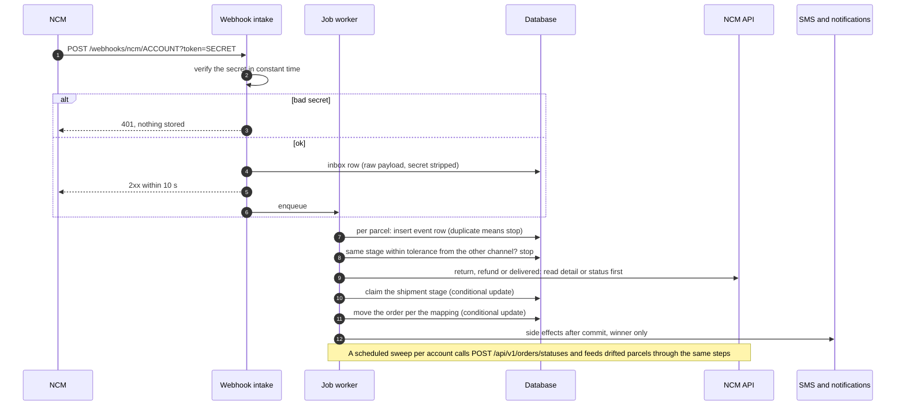

# Nepal Can Move (NCM) integration reference

A single-file reference for integrating the Nepal Can Move courier API into an
e-commerce or order-management project. It is generated from the Claude skill in
[`skills/ncm-integration/`](../skills/ncm-integration/SKILL.md); edit the files
under `skills/ncm-integration/references/` and `docs/src/intro.md`, then run
`python3 scripts/build_reference.py`. Never edit this file by hand.

## Sources and labels

| Source | What it is |
|---|---|
| NCM API doc v2 | *NCM API Documentation*, version 2: PDF file name `NCM API DOC V2.pdf`, 32 pages, created 2026-06-21, written against `https://demo.nepalcanmove.com`. The current API document. "v2" is the document's version; most order endpoints are still under `/api/v1/` |
| NCM webhook doc | *NCM Webhook Integration Documentation* v1.1, "Last updated: September 2026", "Beta (subject to changes)". Current, and unchanged since this reference's previous edition |
| NCM API doc v1 | *NCM API Documentation* PDF, file name dated `251222`, 18 pages. Superseded by v2 |
| A production integration | One multi-vendor platform's NCM integration, read in late 2026 and built against the v1 API doc: its code, and its team's production checks |

None of the PDFs is included here; ask NCM for current copies. Nothing in this
reference was checked against NCM's live API.

| Label | Meaning |
|---|---|
| **[doc]** | Stated in NCM's current documents (API doc v2, webhook doc v1.1) |
| **[v1 doc]** | Stated only in the superseded v1 API doc. Kept to help migrate old code |
| **[inferred]** | Follows from the documents without being stated |
| **[observed]** | Seen in the production integration's code. Code shows what it *handles*, not what NCM *sends* |
| **[reported]** | Reported by that integration's team from production checks |
| **[recommended]** | A design rule for your project |
| **[unknown]** | Not settled by any source, including what API doc v2 leaves unspecified |
| **[NCM, date]** | Answered by NCM outside its documents, recorded in the open questions below |

## Breaking changes from the v1 API doc

| Change | Before [v1 doc] | Now [doc] |
|---|---|---|
| Generic ticket path | `POST /api/v2/vendor/ticket/create` | `POST /api/v2/vendor/ticket/create/new` |
| Pickup tickets | `ticket_type` and `message` | also `branch`, one of the account's assigned pickup branches (`GET /api/v2/vendor/assigned-branches`) |

Everything else in v2 is additive: higher daily limits (1,000 creates and 20,000
reads, up from 200 and 5,000), a documented webhook-URL endpoint and webhook
test, ticket detail and replies, customer list, detail and rating stats,
assigned branches, and label data. The text of every other v1 endpoint is
unchanged, and its path with it.

## Capability matrix

| Capability | NCM endpoint | Documented | Used by the production integration |
|---|---|---|---|
| Branch list | `GET /api/v2/branches` | yes (shape not given) | yes |
| Assigned pickup branches | `GET /api/v2/vendor/assigned-branches` | yes, new in v2 | no |
| Delivery charge | `GET /api/v1/shipping-rate` | yes (shape not given) | yes, always `type=Pickup/Collect` |
| Create order | `POST /api/v1/order/create` | yes | yes, one at a time, on confirmation |
| Order detail | `GET /api/v1/order?id=` | yes | yes |
| Order comments; last 25 comments | `GET /api/v1/order/comment?id=`; `GET /api/v1/order/getbulkcomments` | yes | yes |
| Status history; bulk status | `GET /api/v1/order/status?id=`; `POST /api/v1/orders/statuses` | yes | yes (reconciliation) |
| Post a comment | `POST /api/v1/comment` | yes | yes |
| Tickets: create, COD transfer, close | `POST /api/v2/vendor/ticket/create/new`, `…/ticket/cod/create`, `…/ticket/close/<id>` | yes; the create path changed in v2 | create (at the v1 path) and close, for pickup requests; COD transfer unused |
| Ticket detail; ticket reply | `GET /api/v1/tickets/<id>/detail`; `POST /api/v1/vendor/tickets/<id>/response` | yes, new in v2 | detail yes (before it was documented); reply no |
| Staff list | `GET /api/v2/vendor/staffs` | yes | no |
| Return, exchange | `POST /api/v2/vendor/order/return`, `…/exchange-create` | yes | no |
| Redirect | `POST /api/v2/vendor/order/redirect` | yes | yes |
| Register, test webhook URL | `POST /api/v2/vendor/webhook`, `…/webhook/test` | yes, new in v2 (order status URL only) | no |
| Status webhooks | 10 events | yes (webhook doc v1.1) | 5 events; return and refund events were dropped (a mistake, see lessons) |
| Customers; customer detail; rating stats | `GET /api/v2/vendor/customers`, `…/customers/<id>/detail`; `GET /api/v2/vendor/ratings?phone=` | yes, new in v2 | ratings yes (before it was documented); customers no |
| Label data, one or many | `GET /api/v2/vendor/order/label/<id>`; `POST /api/v2/vendor/order/label/` | yes, new in v2 | no |
| `comment_added` webhook | none | no (v2 mentions "comment events" without a payload) | yes |
| Redirectable list | `GET /api/v2/vendor/order/redirectable` | no | yes |
| Cancel or hold an order | none | **not offered** | posts a comment instead |

## Recommended event flow [recommended]

## Discrepancies in NCM's own documents

| # | Topic | What the documents say |
|---|---|---|
| 1 | Webhook URL API | The endpoint is described as managing "webhook URLs" for "order status and comment events", and answers "Webhook URLs updated", but its only parameter is `webhook_url`, the order status URL |
| 2 | Delivery-type names | Three vocabularies: the rate endpoint takes `Pickup/Collect`, `Send`, `D2B`, `B2B`; create takes `Door2Door`, `Branch2Door`, `Door2Branch`, `Branch2Branch`; labels report `Home` or `Office`. The rate-to-create pairing is [inferred] from the rate table's descriptions |
| 3 | Branch list auth | Every other endpoint shows `Authorization: Token`; the branch list shows no header |
| 4 | Order detail fields | Five fields documented; live responses appear to carry more, such as `vendor_return` [reported] |
| 5 | Returns | After `rtv_delivery` the order reads `Delivered`, so a return ends looking like a delivery |
| 6 | Vendor spelling | The webhook label is `Send to Vendor`; the order's status is `Sent to Vendor` |
| 7 | Timestamps | Webhooks are UTC; the status, ticket and customer APIs and both test payloads use `+05:45` |
| 8 | Bulk comments | Said to be newest first; the doc's own example isn't sorted |
| 9 | Pickup statuses | `Pickup Order Created` and `Sent for Pickup` appear in API examples but have no webhook event |
| 10 | Undocumented events | `comment_added` [observed] and `returned_to_warehouse` [reported] arrive but aren't listed |
| 11 | Redirect destination | Takes a branch **id**; create takes branch **names**; assigned branches return names and labels return a name and a `code`; no documented source of branch ids |
| 12 | Branch-name case | Rates, create and assigned branches use capitals (`TINKUNE`, `KATHMANDU`); the pickup-ticket example sends `Tinkune` |
| 13 | Ticket paths | Create and close are under `/api/v2/vendor/ticket/`; detail is under `/api/v1/tickets/` and replies under `/api/v1/vendor/tickets/`. The v1 create path was dropped without a note |
| 14 | Ticket detail sample | The braces put `responses` beside `ticket`; the indentation puts it inside |
| 15 | Webhook test | Answers `success: true` when your server returned an error status; only `status_code` tells you it failed |
| 16 | Label handling | Labels report `handling` (Fragile, Valuable, ...); create has no field to set it |
